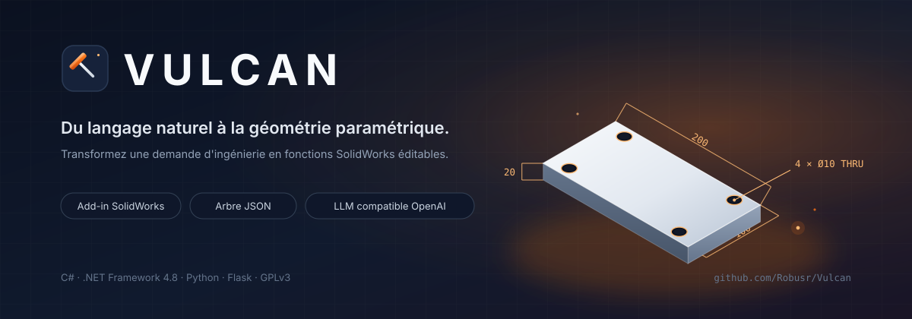
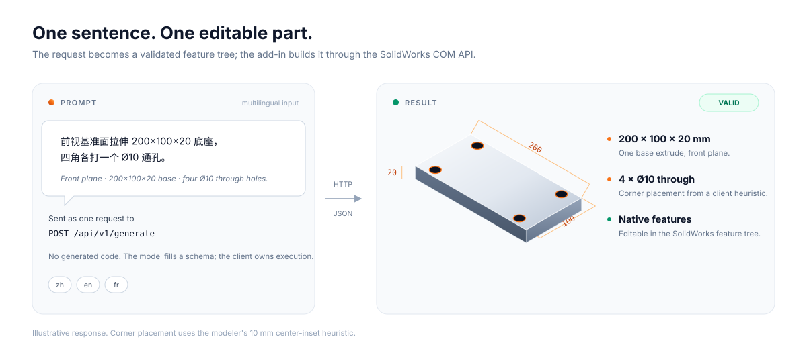
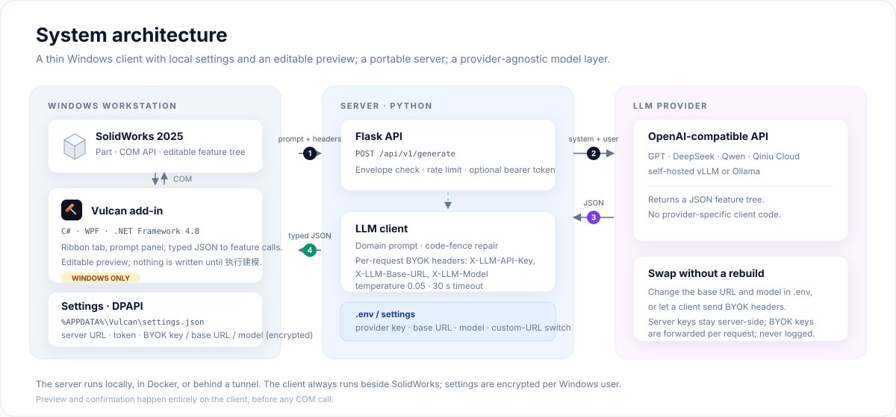
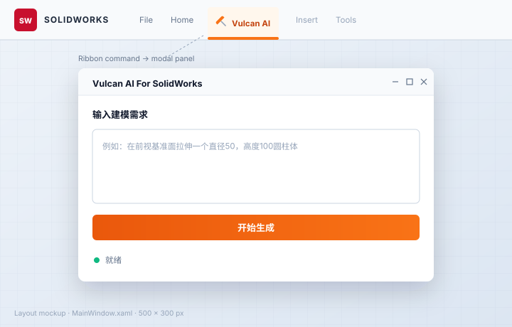
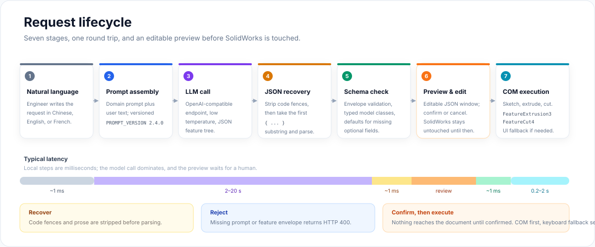
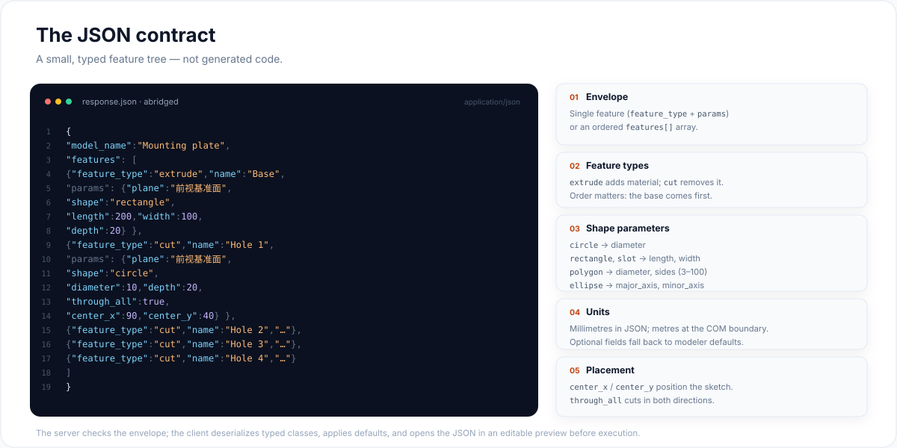
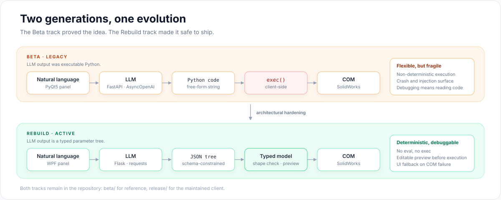

<p align="center">
  
</p>

<h1 align="center">Vulcan</h1>

<p align="center">
  <strong>Le langage naturel en entrée. La géométrie paramétrique SolidWorks en sortie.</strong><br>
  Un module complémentaire qui transforme une demande d’ingénierie en fonctions SolidWorks éditables.
</p>

<p align="center">
  <a href="https://github.com/Robusr/Vulcan/stargazers"></a>
  <a href="https://github.com/Robusr/Vulcan/network/members"></a>
  
  
  
  
  <a href="LICENSE"></a>
</p>

<p align="center">
  <a href="README.md">English</a> ·
  <a href="README.zh-CN.md">简体中文</a> ·
  <a href="README.fr.md"><strong>Français</strong></a>
</p>

<p align="center">
  <a href="#origine-du-nom">Origine du nom</a> ·
  <a href="#ce-quil-fait">Ce qu’il fait</a> ·
  <a href="#capacités">Capacités</a> ·
  <a href="#architecture-du-système">Architecture</a> ·
  <a href="#le-contrat-json">Contrat JSON</a> ·
  <a href="#démarrage-rapide">Démarrage rapide</a> ·
  <a href="#feuille-de-route">Feuille de route</a>
</p>

<p align="center">
  
</p>

## Origine du nom

SolidWorks est précis, puissant et réputé pour ses clics à répétition. Une plaque de montage percée de quatre trous demande souvent une douzaine d’opérations : choisir un plan, dessiner un rectangle, coter, quitter l’esquisse, extruder, sélectionner une face, dessiner des cercles, les répéter, puis couper de part en part.

Vulcan compresse cette séquence en une phrase. Le nom vient de Vulcain, dieu romain du feu et de la métallurgie — la forge où la matière brute rencontre une intention délibérée. Ici, la matière première est le langage et l’intention est un arbre de fonctions paramétrique.

Le dépôt contient deux générations de l’idée :

- **`beta/`** — la preuve de concept d’origine. Le LLM générait du code Python, que le client exécutait avec `exec()`.
- **`release/`** — l’architecture maintenue. Le LLM renvoie un arbre de fonctions JSON typé, exécuté de manière déterministe par un add-in C#.

Ce README se concentre sur `release/`. La piste Beta est conservée comme référence et comme récit de conception.

## Ce qu’il fait

<p align="center">
  
</p>

<p align="center">
  <sub>Réponse illustrative. Le même contrat accepte une extrusion de base suivie d’une liste ordonnée de coupes.</sub>
</p>

1. **Décrivez la pièce.** Saisissez une demande dans le panneau de l’add-in. Les modèles multilingues comprennent le chinois, l’anglais et le français ; le prompt système est lui-même rédigé en chinois.
2. **Le modèle remplit un schéma.** Le serveur préfixe la demande avec un prompt métier SolidWorks versionné et appelle n’importe quel point d’accès compatible OpenAI. Le modèle renvoie du JSON, pas du code.
3. **L’add-in construit la pièce.** Le client C# désérialise l’arbre, dessine les esquisses et appelle l’API COM de SolidWorks. Le résultat est un arbre de fonctions natif et éditable.

## Capacités

| Capacité | Ce que cela signifie |
|---|---|
| Modélisation en langage naturel | Une demande devient un arbre de fonctions ordonné, avec une base puis des fonctions successives. |
| Sortie native | Des fonctions SolidWorks éditables, pas un maillage, une macro ou un script généré. |
| Contrat structuré | Une enveloppe JSON avec des fonctions `extrude` et `cut` ; des millimètres en entrée, des mètres à la frontière COM. |
| Bibliothèque de formes | Profils cercle, rectangle, polygone, ellipse et rainure. |
| Placement des trous | `center_x` et `center_y` explicites, `through_all`, et une heuristique pour les quatre coins. |
| Liberté de fournisseur | OpenAI, DeepSeek, Qwen, Qiniu Cloud, vLLM, Ollama ou tout point d’accès compatible. |
| Serveur portable | Fonctionne en local, dans Docker ou derrière un tunnel ; seul le client exige Windows. |
| Chaîne de traitement débogable | Pas de `exec()` dans la version release ; chaque étape est journalisée et typée. |
| Exécution API d’abord | Appels COM prioritaires, avec un repli clavier dans l’interface native si l’appel échoue. |

## Architecture du système

<p align="center">
  
</p>

| Couche | Pile technique | Responsabilité |
|---|---|---|
| Client | C# / WPF / .NET Framework 4.8 | Onglet `Vulcan AI`, panneau de saisie, traitement de l’enveloppe JSON, exécution COM |
| Transport | HTTP REST / JSON | Point d’accès unique : `POST /api/v1/generate` |
| Serveur | Python 3.9+ / Flask 3 | Assemblage du prompt, appel du LLM, contrôle de l’enveloppe, correspondance des erreurs |
| Modèle | API compatible OpenAI | Génération de l’arbre de fonctions JSON |
| Déploiement | Docker, proxy inverse ou serveur dédié | Serveur n’importe où ; client à côté de SolidWorks |

Le module complémentaire enregistre un onglet `Vulcan AI` pour les pièces, les assemblages et les mises en plan, ainsi qu’une barre d’outils et une commande de menu. Le bouton ouvre un panneau WPF modal ; ce n’est pas une application de CAO séparée.

<p align="center">
  
</p>

<p align="center">
  <sub>Maquette de mise en page du panneau de 500 × 300 px. L’interface livrée est en chinois ; le panneau accepte des demandes en langage naturel.</sub>
</p>

## Cycle d’une requête

<p align="center">
  
</p>

1. **Requête.** L’add-in envoie `{ "prompt": "..." }` au serveur Flask.
2. **Assemblage du prompt.** Le serveur préfixe le texte utilisateur avec le prompt métier versionné.
3. **Appel du modèle.** Un point d’accès compatible OpenAI renvoie un arbre de fonctions JSON. La requête par défaut utilise `temperature 0.05`, `top_p 0.95`, `max_tokens 2048` et un délai de 30 secondes.
4. **Récupération.** Le serveur retire les balises de code Markdown, puis extrait du premier `{` au dernier `}` avant l’analyse.
5. **Validation.** Flask vérifie que la réponse contient une enveloppe mono-fonction ou multi-fonctions. Le client C# désérialise l’enveloppe en classes typées, puis lit les paramètres de fonction dans un dictionnaire et applique les valeurs par défaut du modeleur.
6. **Exécution.** `SwModeler` dessine l’esquisse, la sélectionne et appelle `FeatureExtrusion3` ou `FeatureCut4`. Si l’appel COM échoue, un repli clavier ouvre le panneau natif de SolidWorks.

L’appel au modèle domine la latence. Tout le reste est local et se mesure généralement en millisecondes.

## Le contrat JSON

<p align="center">
  
</p>

### Enveloppe

Une réponse est soit une fonction unique :

```json
{
  "feature_type": "extrude",
  "name": "Cylinder",
  "params": {
    "plane": "前视基准面",
    "shape": "circle",
    "diameter": 50,
    "depth": 100
  }
}
```

soit un modèle multi-fonctions ordonné :

```json
{
  "model_name": "Mounting plate",
  "features": [
    {
      "feature_type": "extrude",
      "name": "Base",
      "params": {
        "plane": "前视基准面",
        "shape": "rectangle",
        "length": 200,
        "width": 100,
        "depth": 20
      }
    },
    {
      "feature_type": "cut",
      "name": "Hole 1",
      "params": {
        "plane": "前视基准面",
        "shape": "circle",
        "diameter": 10,
        "depth": 20,
        "through_all": true,
        "center_x": 90,
        "center_y": 40
      }
    }
  ]
}
```

Un seul des quatre trous est représenté. La réponse complète répète la fonction `cut` avec les autres coordonnées de coin.

### Schéma des fonctions

| Champ | Type | Requis | Remarques |
|---|---|---|---|
| `feature_type` | chaîne | oui | `extrude` ou `cut` |
| `name` | chaîne | non | Libellé lisible utilisé dans les journaux |
| `params.plane` | chaîne | oui | Plan demandé ; voir la note d’implémentation |
| `params.shape` | chaîne | oui | `circle`, `rectangle`, `polygon`, `ellipse` ou `slot` |
| `params.depth` | nombre | oui | Profondeur en millimètres ; ignorée si `through_all` est vrai |
| `params.through_all` | booléen | non | Coupes uniquement ; `false` par défaut ; coupe dans les deux sens si vrai |
| `params.center_x` | nombre | coupes multi-trous | Centre de l’esquisse sur le premier axe, en millimètres |
| `params.center_y` | nombre | coupes multi-trous | Centre de l’esquisse sur le second axe, en millimètres |

### Paramètres de forme

| Forme | Champs requis | Remarques |
|---|---|---|
| `circle` | `diameter` | Millimètres |
| `rectangle` | `length`, `width` | Centré sur `center_x`, `center_y` |
| `polygon` | `diameter`, `sides` | `sides` limité à 3–100 |
| `ellipse` | `major_axis`, `minor_axis` | Millimètres |
| `slot` | `length`, `width` | Rainure droite ; la largeur est le diamètre des extrémités |

### Coordonnées et unités

- **Plan de face :** les axes de l’esquisse sont X et Y ; `center_x` correspond à X et `center_y` à Y.
- **Plan de dessus :** les axes sont X et Z ; `center_y` correspond à Z et doit rester dans l’épaisseur de la base.
- **Plan de droite :** les axes sont Y et Z ; `center_x` correspond à Y et `center_y` à Z.
- **Modèles multi-fonctions :** lisez d’abord `length`, `width` et `depth` de la base, puis calculez les coordonnées suivantes. Ne placez jamais plusieurs fonctions identiques en `(0, 0)`.
- **Unités :** toutes les dimensions du JSON sont en millimètres. Le modeleur convertit en mètres à la frontière COM.

### Note d’implémentation

Le modeleur de la version release normalise actuellement les esquisses sur le plan de face. Le champ `plane` fait partie du contrat et est utilisé par le prompt, mais le routage général des plans figure sur la feuille de route. Pour une disposition aux quatre coins, le client applique une heuristique qui place les coupes à `±(length / 2 − 10)` et `±(width / 2 − 10)` lorsque la demande mentionne explicitement des trous de coin en chinois.

## Décisions de conception

<p align="center">
  
</p>

### Des paramètres JSON plutôt que du code généré

La piste Beta laissait le LLM produire du code Python que le client exécutait avec `exec()`. C’était souple et spectaculaire en démonstration, mais fragile en pratique : un appel d’API halluciné pouvait faire planter SolidWorks, la reprise sur erreur était presque impossible et le débogage consistait à lire un code que personne n’avait écrit.

La piste Rebuild traite le LLM comme un **paramétreur guidé par un schéma**. Le modèle remplit un petit gabarit typé. Le client C# possède l’exécution. Si le JSON est valide, les appels de fonctions sont bien formés. S’il ne l’est pas, le contrôle d’enveloppe le rejette avant que SolidWorks ne soit touché. Il n’y a ni `exec()` ni surface d’injection de code dans le client release.

### Un client mince, un serveur portable

1. **Les clés restent côté serveur.** Intégrer une clé d’API LLM dans une macro cliente n’est pas acceptable.
2. **Les prompts évoluent vite.** Mettre à jour un prompt serveur prend quelques secondes ; livrer un nouvel add-in exige une compilation et une réinstallation.
3. **Le serveur peut tourner sans interface.** Cela préserve la possibilité de traitement par lots, de contrôles CI et d’une future interface web.

### Un prompt métier, pas un prompt générique

Les modèles généralistes échouent en CAO non par manque d’intelligence, mais par manque de contexte. Ils ne connaissent pas la différence entre un plan de face et un plan de dessus, ni le fait qu’une coordonnée Z de coupe doit rester dans l’épaisseur de la base.

Vulcan fournit ce contexte via [`system_prompt.py`](release/server/prompts/system_prompt.py) : correspondances plan-axes, schémas de fonctions, champs propres aux formes, discipline de sortie et règle anti-chevauchement pour les modèles multi-fonctions.

### API d’abord, interface en repli

L’interopérabilité SolidWorks est sensible aux versions. Le modeleur appelle directement `FeatureExtrusion3` et `FeatureCut4`. Si l’appel échoue, le repli active `RunCommand` et remplit le panneau natif de SolidWorks par des frappes simulées.

Le repli est pragmatique, pas élégant. Gardez SolidWorks au premier plan pendant la génération, et considérez un repli fréquent comme un signal pour mettre à jour les paramètres d’interopérabilité.

## Ingénierie du prompt

Le prompt système se trouve dans [`release/server/prompts/system_prompt.py`](release/server/prompts/system_prompt.py) et est versionné par `PROMPT_VERSION = "2.0.0"` (environ 140 lignes). Il encode cinq éléments :

1. **Discipline de sortie.** JSON uniquement — pas de Markdown, pas de prose, pas de balises de code.
2. **Règles de coordonnées.** Correspondances axe-plan, avec un exemple travaillé pour une base de 200 × 100 × 20 et quatre trous.
3. **Schéma des fonctions.** Champs requis et optionnels pour `extrude` et `cut`, plus les paramètres propres aux formes.
4. **Contrainte anti-chevauchement.** Plusieurs fonctions identiques doivent utiliser des coordonnées distinctes ; jamais empilées à l’origine.
5. **Vocabulaire des plans.** Le modèle doit produire des noms de plans chinois tels que `前视基准面`, `上视基准面` et `右视基准面`.

Le prompt est délibérément séparé de la logique métier pour pouvoir être itéré sans toucher au serveur. L’appel utilise une température basse, car la tâche récompense la cohérence, pas la créativité.

## Démarrage rapide

### Prérequis

| Composant | Exigence |
|---|---|
| Serveur | Python 3.9–3.11 et une clé API compatible OpenAI |
| Client | Windows 10/11, SolidWorks 2025 (testé), .NET Framework 4.8 |
| Outils de build | Visual Studio 2022 avec la charge de travail .NET Desktop |
| Réseau | Le client doit joindre le serveur ; le serveur doit joindre le fournisseur LLM |

### 1. Cloner le dépôt

```bash
git clone https://github.com/Robusr/Vulcan.git
cd Vulcan
```

### 2. Démarrer le serveur

```bash
cd release/server

python -m venv venv
source venv/bin/activate   # Windows : venv\Scripts\activate

pip install -r requirements.txt
cp .env.example .env
# Éditez .env : clé du fournisseur, URL de base et nom du modèle

python app.py
# → http://0.0.0.0:5000
```

L’`app.py` actuel lie explicitement le port 5000 et active le mode debug de Flask. Modifiez ces deux réglages avant d’exposer le serveur hors d’un réseau de confiance.

### 3. Ou lancer avec Docker

```bash
cd release/server
docker build -t vulcan-server .
docker run --rm -p 5000:5000 --env-file .env vulcan-server
```

### 4. Vérifier l’API

```bash
curl -s http://127.0.0.1:5000/api/v1/generate \
  -H "Content-Type: application/json" \
  -d '{"prompt":"前视基准面拉伸200x100x20底座，四角各打一个直径10mm通孔"}'
```

La réponse est l’arbre de fonctions lui-même, sans enveloppe supplémentaire. La première requête peut prendre quelques secondes pendant l’appel au modèle.

### 5. Installer ou compiler le client

**Option A — installateur précompilé.** Exécutez `release/client/Vulcan.SolidWorksClient/Vulcan Setup/Output/Vulcan.exe` sous Windows. L’installateur enregistre l’add-in avec `RegAsm`. Le client compilé utilise le point d’accès codé en dur dans `Services/ApiClient.cs` ; compilez depuis les sources pour utiliser votre propre serveur.

**Option B — compilation depuis les sources.**

1. Ouvrez `release/client/Vulcan.SolidWorksClient/Vulcan.SolidWorksClient.sln` dans Visual Studio 2022.
2. Restaurez les paquets NuGet (le client utilise `Newtonsoft.Json`).
3. Pointez les références d’interopérabilité SolidWorks vers votre installation. Le projet contient des chemins `HintPath` absolus sous `D:\Program Files\SOLIDWORKS Corp\...` ; mettez-les à jour, ou utilisez les assemblys correspondants de `ReferenceDLL/`.
4. Définissez `_baseUrl` dans [`ApiClient.cs`](release/client/Vulcan.SolidWorksClient/Services/ApiClient.cs) vers votre serveur.
5. Compilez en `Release / x64`. SolidWorks est 64 bits ; ne livrez pas de build x86.
6. Enregistrez l’add-in depuis une invite de commandes élevée dans le dossier de sortie avec `install.bat`, ou exécutez `RegAsm.exe Vulcan.SolidWorksClient.dll /codebase`.
7. Redémarrez SolidWorks et ouvrez une pièce. L’onglet `Vulcan AI` doit apparaître.

### 6. Générer la première pièce

Ouvrez le panneau Vulcan et essayez l’une de ces demandes :

```text
前视基准面拉伸200x100x20底座，四角各打一个直径10mm通孔
```

```text
Create a 200 x 100 x 20 mm base on the front plane, with a 10 mm through hole at each corner.
```

```text
Créez une base de 200 x 100 x 20 mm sur le plan de face, avec un trou traversant de 10 mm à chaque coin.
```

Cliquez sur **开始生成** (Générer). L’add-in construit les fonctions, ajuste la vue et laisse un arbre de fonctions éditable.

## Configuration

### Environnement serveur

```env
QINIU_API_KEY="sk-xxxxxxxxxxxxxxxx"
QINIU_BASE_URL="https://api.openai.com/v1"
QINIU_MODEL="gpt-4o-mini"

FLASK_ENV="development"
FLASK_RUN_PORT="5000"
```

Les noms `QINIU_*` sont historiques : le premier déploiement utilisait Qiniu Cloud. Le client est compatible OpenAI, donc ces noms n’ont de sens que pour `config.py`.

| Variable | Valeur par défaut | Rôle |
|---|---|---|
| `QINIU_API_KEY` | aucune | Clé API du fournisseur |
| `QINIU_BASE_URL` | aucune | URL de base compatible OpenAI |
| `QINIU_MODEL` | `gpt-oss-120b` | Nom du modèle |
| `FLASK_ENV` | aucune | Lu par `Config.DEBUG` ; le point d’entrée force encore `debug=True` |
| `FLASK_RUN_PORT` | `5000` | Lu par `config.py` ; `app.py` actuel lie directement 5000 |

### Exemples de fournisseurs

| Fournisseur | `QINIU_BASE_URL` | Exemple de modèle |
|---|---|---|
| OpenAI | `https://api.openai.com/v1` | `gpt-4o-mini` |
| DeepSeek | `https://api.deepseek.com/v1` | `deepseek-chat` |
| Qwen (mode compatible DashScope) | `https://dashscope.aliyuncs.com/compatible-mode/v1` | `qwen-plus` |
| Ollama | `http://localhost:11434/v1` | un modèle servi localement |
| vLLM | `http://localhost:8000/v1` | votre modèle servi |

Utilisez un modèle fort en suivi d’instructions et fiable en sortie JSON. Les modèles faibles produisent les échecs classiques : balises Markdown, prose avant le JSON ou coordonnées qui se chevauchent.

### Point d’accès du client

```csharp
private readonly string _baseUrl = "http://127.0.0.1:5000";
```

La source livrée pointe vers un hôte codé en dur. Modifiez-la avant de compiler pour votre propre déploiement.

### Réglages

- `temperature 0.05`, `top_p 0.95`, `max_tokens 2048` dans [`llm_client.py`](release/server/services/llm_client.py) contrôlent l’appel au modèle.
- `LLM_TIMEOUT = 30` dans [`config.py`](release/server/config.py) contrôle le délai côté serveur.
- `ApiClient` utilise un délai de 30 secondes. Si vous augmentez l’un, augmentez l’autre.

## Référence API

### `POST /api/v1/generate`

Requête :

```json
{
  "prompt": "前视基准面拉伸200x100x20底座，四角各打一个直径10mm通孔"
}
```

Succès — `200 OK` avec l’arbre de fonctions :

```json
{
  "model_name": "Mounting plate",
  "features": [
    {
      "feature_type": "extrude",
      "name": "Base",
      "params": {
        "plane": "前视基准面",
        "shape": "rectangle",
        "length": 200,
        "width": 100,
        "depth": 20
      }
    }
  ]
}
```

Les erreurs utilisent une petite enveloppe :

```json
{
  "message": "缺少必要字段: prompt",
  "status": "error"
}
```

| Statut | Condition |
|---|---|
| `400` | `prompt` absent ou vide, ou aucune enveloppe de fonctions valide |
| `503` | Le fournisseur LLM est injoignable ou la requête a expiré |
| `500` | La réponse du LLM est illisible, ou une erreur serveur inconnue est survenue |

**Sécurité.** Le serveur n’a ni authentification, ni autorisation, ni limitation de débit, ni politique CORS. Ne l’exposez pas directement à l’internet public. Placez-le derrière un proxy inverse, ajoutez authentification et quotas, et désactivez d’abord le mode debug de Flask.

## Structure du projet

```text
Vulcan/
├── README.md                     # Anglais (par défaut)
├── README.zh-CN.md               # Chinois simplifié
├── README.fr.md                  # Français
├── docs/
│   └── assets/                   # Figures vectorielles communes aux trois README
│
├── beta/                         # Ancienne piste de génération de code
│   ├── client-csharp-beta/       #   Prototype d’onglet et de groupes de commandes
│   ├── client-python-beta/       #   Client PyQt5 avec exécution par exec()
│   └── server-python-beta/       #   Serveur FastAPI + AsyncOpenAI
│
└── release/                      # Piste active du contrat JSON
    ├── client/
    │   └── Vulcan.SolidWorksClient/
    │       ├── Core/             #   SwAddIn — enregistrement COM et cycle de vie
    │       ├── Models/           #   ModelData — types de requête et réponse
    │       ├── Services/         #   ApiClient, SwModeler, Logger
    │       ├── UI/               #   MainWindow (WPF, 500 × 300)
    │       ├── ReferenceDLL/     #   Assemblys d’interopérabilité SolidWorks
    │       └── Vulcan Setup/     #   Installateur Inno Setup
    └── server/
        ├── app.py                #   Point d’entrée Flask
        ├── config.py             #   Configuration par environnement
        ├── .env.example          #   Modèle de configuration fournisseur et Flask
        ├── Dockerfile            #   Image python:3.9-slim
        ├── prompts/              #   Prompt système versionné
        ├── services/             #   Client LLM
        └── utils/                #   Journalisation et exceptions
```

**Notes sur le dépôt.** Le fichier projet compile `Core/SwAddIn.cs` ; `VulcanApp.cs` à la racine du client est un ancien doublon qui ne fait pas partie du build. Le module `services/param_parser.py` est un validateur hérité, non branché sur `app.py` de la version release ; les valeurs par défaut des champs se trouvent dans `SwModeler`.

## Compatibilité et périmètre actuel

| Domaine | État |
|---|---|
| SolidWorks | Construit contre l’interface d’interopérabilité 2025 (`FeatureExtrusion3`, `FeatureCut4`). Les versions antérieures peuvent nécessiter des ajustements de paramètres ou le repli interface ; elles ne font pas partie de la matrice testée. |
| Plateforme client | Windows uniquement, x64, .NET Framework 4.8. |
| Plateforme serveur | Python 3.9–3.11 ; local, Docker ou sans interface. |
| Types de fonctions | `extrude` et `cut` uniquement. Révolution, balayage, lissage, congé et chanfrein ne sont pas implémentés dans le client release. |
| Plans | Le modeleur normalise actuellement les esquisses sur le plan de face ; le routage des plans est sur la feuille de route. |
| Validation | Le serveur contrôle l’enveloppe de réponse ; la désérialisation de l’enveloppe, la conversion des paramètres et les valeurs par défaut sont dans le client C#. |
| Authentification | Aucune intégrée. Déployez sur un réseau de confiance ou ajoutez un proxy avec authentification et limitation de débit. |
| Qualité du LLM | La latence et la justesse dépendent du fournisseur. Utilisez un modèle fort en suivi d’instructions. |

## Dépannage

| Symptôme | Cause probable | Solution |
|---|---|---|
| L’onglet `Vulcan AI` n’apparaît pas | L’add-in n’est pas enregistré, ou la compilation cible x86 | Compilez la configuration x64 Release, exécutez `install.bat` ou `RegAsm` en administrateur, redémarrez SolidWorks |
| « Connexion refusée » | Le serveur ne tourne pas, ou `_baseUrl` est incorrect | Lancez `python app.py` ; vérifiez l’hôte et le port ; ouvrez le pare-feu |
| Aucun document actif | SolidWorks n’a pas de pièce ouverte | Créez ou ouvrez une pièce, puis relancez la génération |
| L’esquisse apparaît, l’extrusion échoue | Incompatibilité d’interopérabilité ou état SolidWorks obsolète | Consultez `Desktop/Vulcan_Logs` ; mettez à jour les paramètres de `FeatureExtrusion3` ; gardez SolidWorks au premier plan |
| Le LLM renvoie une réponse vide ou mal formée | Le modèle a ignoré le contrat JSON | Passez à un modèle plus fort, baissez `temperature`, consultez `vulcan_server.log` |
| La requête expire | Le modèle dépasse 30 secondes | Augmentez `LLM_TIMEOUT` et le délai de `ApiClient` ensemble |
| Une demande en chinois ou en français est mal comprise | Le modèle manque de vocabulaire technique multilingue | Utilisez un modèle multilingue ; le prompt système est en chinois |
| La compilation échoue sur les références SolidWorks | `HintPath` pointe vers une autre installation | Mettez à jour les références ou utilisez les DLL correspondantes de `ReferenceDLL/` |
| L’enregistrement de l’installateur échoue | SolidWorks tourne, ou le shell n’est pas élevé | Fermez SolidWorks et relancez l’installateur en administrateur |
| La pièce apparaît mais les trous sont mal placés | Le plan ou la convention de coordonnées ne correspond pas à la demande | Inspectez le JSON renvoyé ; rappelez-vous la normalisation sur le plan de face |

Les journaux serveur sont écrits dans `vulcan_server.log` dans le répertoire de travail. Les journaux client sont écrits dans `Vulcan_Logs/log_YYYYMMDD.txt` sur le bureau.

## Feuille de route

- [ ] Routage général des plans au lieu de la normalisation sur le plan de face.
- [ ] Fonctions révolution, balayage, lissage, congé et chanfrein.
- [ ] Motifs de trous natifs, symétrie et répétitions linéaires ou circulaires.
- [ ] Prompts système natifs en anglais et en français, pas seulement le comportement multilingue du modèle.
- [ ] Adaptateurs de fournisseurs et réponses en flux.
- [ ] Authentification, limitation de débit et quotas par utilisateur.
- [ ] Tests de régression des prompts et couche COM simulée pour la CI.
- [ ] Interface en volet des tâches au lieu d’un panneau modal.
- [ ] Opérations au niveau assemblage et annotations de mise en plan.

## Contribuer

Les pull requests sont les bienvenues. Pour les changements importants, ouvrez d’abord une issue afin de discuter de l’approche.

Domaines où l’aide est précieuse :

- **Fonctions :** ajouter de nouveaux types et gestionnaires de formes dans `SwModeler`.
- **Fournisseurs :** abstraire davantage le client LLM et ajouter des adaptateurs.
- **Tests :** construire des tests de régression de prompts et une abstraction COM exécutable en CI.
- **Documentation :** améliorer les trois README ou ajouter des captures et exemples localisés.

Avant d’ouvrir une pull request, lancez le serveur, exécutez au moins un prompt de bout en bout et gardez `.env`, journaux et artefacts de build hors du commit. Le projet est sous GPLv3 ; les contributions sont acceptées sous la même licence.

## Licence

Distribué sous **GNU General Public License v3.0**. Les œuvres dérivées doivent également être open source sous GPLv3. Voir [LICENSE](LICENSE) pour le texte complet.

---

<p align="center">
  <sub>Conçu par <a href="https://github.com/Robusr">Robusr</a> — parce qu’apprendre SolidWorks ne devrait pas exiger un manuel de 200 pages.</sub>
</p>
