<p align="center">
  
</p>

<h1 align="center">Vulcan</h1>

<p align="center">
  <strong>Natural language in. Parametric SolidWorks geometry out.</strong><br>
  An AI add-in that turns a plain engineering request into editable SolidWorks features.
</p>

<p align="center">
  <a href="https://github.com/Robusr/Vulcan/stargazers"></a>
  <a href="https://github.com/Robusr/Vulcan/network/members"></a>
  
  
  
  
  <a href="LICENSE"></a>
</p>

<p align="center">
  <a href="README.md"><strong>English</strong></a> ·
  <a href="README.zh-CN.md">简体中文</a> ·
  <a href="README.fr.md">Français</a>
</p>

<p align="center">
  <a href="#why-vulcan">Why Vulcan</a> ·
  <a href="#what-it-does">What it does</a> ·
  <a href="#capabilities">Capabilities</a> ·
  <a href="#system-architecture">Architecture</a> ·
  <a href="#the-json-contract">JSON contract</a> ·
  <a href="#quick-start">Quick start</a> ·
  <a href="#install-upgrade-and-uninstall">Install</a> ·
  <a href="#operation-walkthrough">Walkthrough</a> ·
  <a href="#testing">Testing</a> ·
  <a href="#roadmap">Roadmap</a>
</p>

<p align="center">
  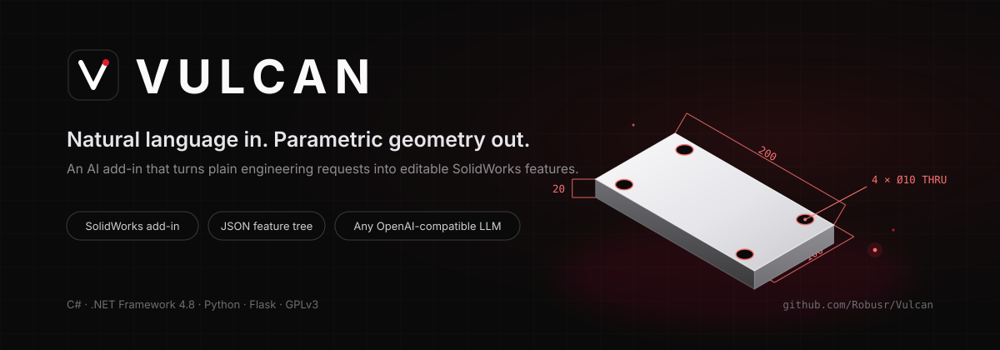
</p>

## Why Vulcan

SolidWorks is precise, powerful, and famously click-heavy. A mounting plate with four holes can take a dozen operations: choose a plane, sketch a rectangle, add dimensions, exit the sketch, extrude, select a face, sketch circles, pattern them, and cut through all.

Vulcan compresses that sequence into one sentence. The name comes from the Roman god of fire and metalworking — the forge where raw material meets deliberate intent. Here the raw material is language, and the intent is a parametric feature tree.

The repository contains two generations of the idea:

- **`archive/beta/`** — the original proof of concept. The LLM generated Python code and the client executed it with `exec()`.
- **`client/` and `server/`** — the maintained architecture. The LLM returns a typed JSON feature tree and a C# add-in executes it deterministically.

This README focuses on `client/` and `server/`. The beta track is archived under `archive/beta/` for reference and design history.

## What it does

<p align="center">
  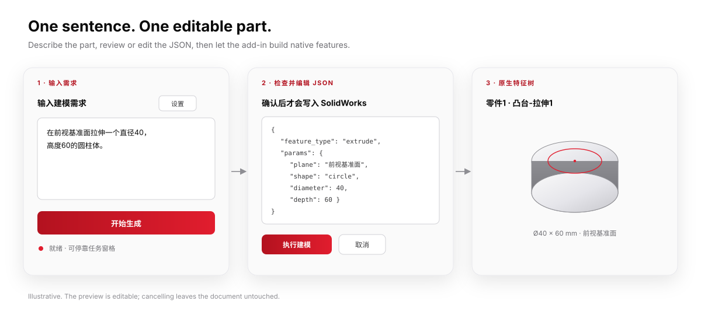
</p>

<p align="center">
  <sub>Illustrative response. The same contract accepts a base extrude followed by an ordered list of cuts.</sub>
</p>

<p align="center">
  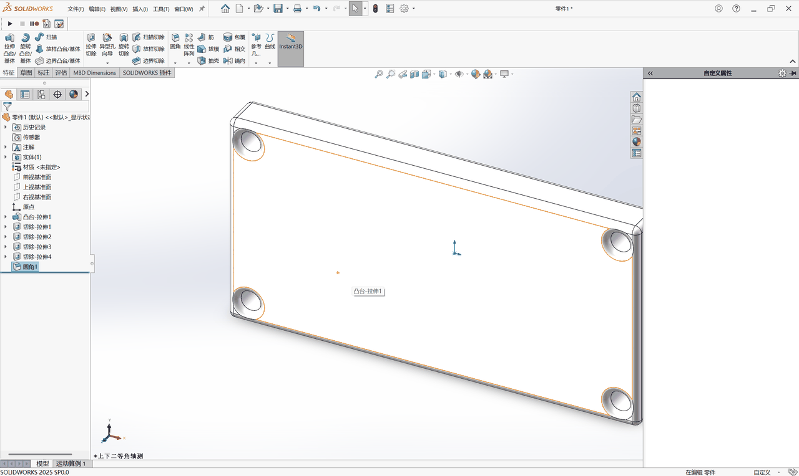
</p>

<p align="center">
  <sub>Real SolidWorks 2025 output: a 200 × 100 × 20 mm plate with four 10 mm through holes and filleted edges. Captured from the local test harness.</sub>
</p>

<p align="center">
  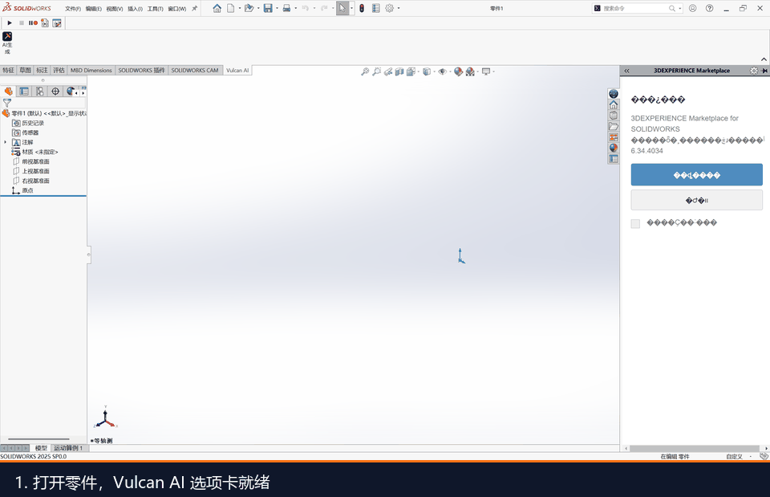
</p>

<p align="center">
  <sub>The shipped 1.2.1 workflow: open the panel, configure the server, describe the part, review the editable JSON, then build native features. Captured from the installed add-in.</sub>
</p>


1. **Describe the part.** Write a request in the add-in panel. Multilingual models handle Chinese, English, and French input; the system prompt itself is written in Chinese.
2. **The model fills a schema.** The server prepends a versioned SolidWorks domain prompt and calls any OpenAI-compatible endpoint. The model returns JSON, not code.
3. **The add-in builds it.** The C# client deserializes the tree, draws sketches, and calls the native SolidWorks feature APIs. The result is a native feature tree you can edit.

## Capabilities

| Capability | What it means |
|---|---|
| Natural-language modeling | One request becomes an ordered feature tree with a base and subsequent features. |
| Native output | Editable SolidWorks features, not a mesh, a macro, or a generated script. |
| Structured contract | A JSON envelope with `extrude`, `cut`, `revolve`, `fillet`, and `chamfer` features; millimetres in, metres at the COM boundary. |
| Shape library | Circle, rectangle, polygon, ellipse, and slot profiles. |
| Feature library | Extrude, cut, revolve, fillet, chamfer, and a hole alias. |
| Hole placement | Explicit `center_x` and `center_y`, `through_all`, and a four-corner heuristic that receives the original prompt in Chinese or English. |
| Provider freedom | OpenAI, DeepSeek, Qwen, Qiniu Cloud, vLLM, Ollama, or any compatible endpoint. |
| Portable server | Runs locally, in Docker, or behind a tunnel; only the client needs Windows. |
| Debuggable pipeline | No `exec()` in the release track; each stage is logged and typed. |
| API-first execution | Native feature APIs first. Extrusion and cut failures fall back to a keyboard-driven native panel. |
| Bring your own key | Set the provider key, base URL, and model in the add-in settings dialog. The key is DPAPI-encrypted on your machine and sent only to your Vulcan server, for the duration of a request. |
| Editable preview | Every response opens in an editable JSON preview. Nothing reaches SolidWorks until you review and confirm the feature tree. |
| Quiet install and uninstall | The installer self-elevates, registers the x64 add-in with `RegAsm`, and uninstalls cleanly without leaving a stale registration behind. |

## System architecture

<p align="center">
  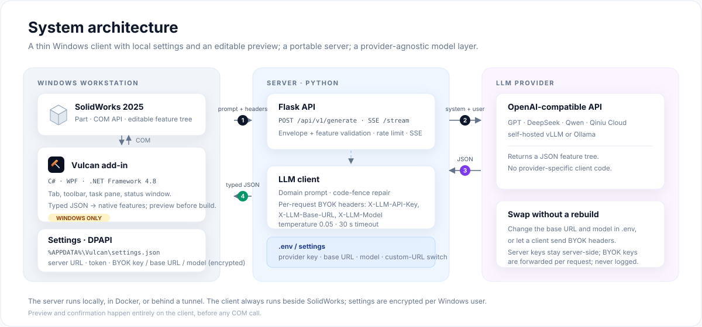
</p>

| Layer | Stack | Responsibility |
|---|---|---|
| Client | C# / WPF / .NET Framework 4.8 | `Vulcan AI` ribbon tab, prompt panel, DPAPI settings, editable JSON preview, COM execution |
| Transport | HTTP REST / JSON | `POST /api/v1/generate`, plus SSE streaming at `POST /api/v1/generate/stream` |
| Server | Python 3.10+ / Flask 3 | Prompt assembly, LLM call, envelope and parameter validation, error mapping |
| Model | OpenAI-compatible API | JSON feature tree generation |
| Deployment | Docker, reverse proxy, or bare metal | Server anywhere; client beside SolidWorks |

The add-in registers a `Vulcan AI` ribbon tab for parts, assemblies, and drawings, plus a toolbar and menu command. The button opens a modal WPF panel; it is not a separate CAD application.

<p align="center">
  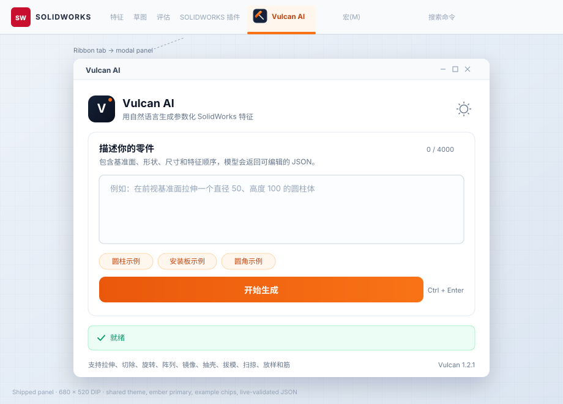
</p>

<p align="center">
  <sub>Layout mockup of the 680 × 520 prompt panel. The shipped UI is Chinese; the panel accepts natural-language requests.</sub>
</p>

## Request lifecycle

<p align="center">
  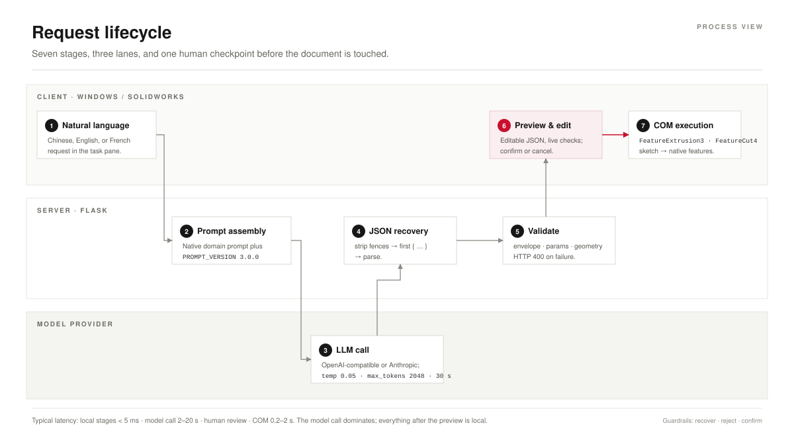
</p>

1. **Request.** The add-in sends `{ "prompt": "..." }` to the Flask server.
2. **Prompt assembly.** The server prepends the versioned SolidWorks domain prompt to the user text.
3. **Model call.** Any OpenAI-compatible endpoint returns a JSON feature tree. The default request uses `temperature 0.05`, `top_p 0.95`, `max_tokens 2048`, and a 30-second timeout.
4. **Recovery.** The server strips markdown code fences, then extracts the first `{` through the last `}` before parsing.
5. **Validation.** Flask checks the envelope and validates feature parameters. The C# client deserializes the envelope into typed model classes, then reads parameters from a dictionary and applies modeler defaults.
6. **Preview and edit.** The add-in opens the feature tree in an editable JSON window; nothing is written until you confirm.
7. **Execution.** `SwModeler` draws the sketch, selects it, and calls the native feature APIs, including `FeatureExtrusion3`, `FeatureCut4`, `FeatureRevolve`, `FeatureFillet3`, and `InsertFeatureChamfer`. Extrusion and cut failures use a keyboard-driven fallback to the native SolidWorks feature panel.

The model call dominates latency. Everything else is local and usually measured in milliseconds.

## The JSON contract

<p align="center">
  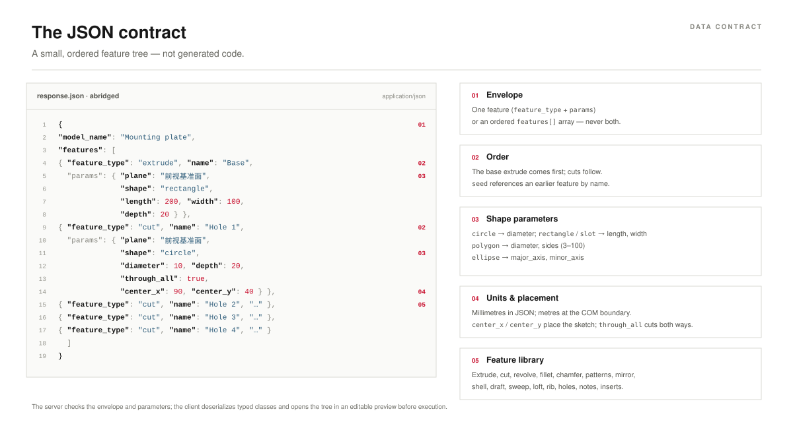
</p>

### Envelope

A response is either a single feature:

```json
{
  "feature_type": "extrude",
  "name": "Cylinder",
  "params": {
    "plane": "前视基准面",
    "shape": "circle",
    "diameter": 50,
    "depth": 100
  }
}
```

or an ordered multi-feature model:

```json
{
  "model_name": "Mounting plate",
  "features": [
    {
      "feature_type": "extrude",
      "name": "Base",
      "params": {
        "plane": "前视基准面",
        "shape": "rectangle",
        "length": 200,
        "width": 100,
        "depth": 20
      }
    },
    {
      "feature_type": "cut",
      "name": "Hole 1",
      "params": {
        "plane": "前视基准面",
        "shape": "circle",
        "diameter": 10,
        "depth": 20,
        "through_all": true,
        "center_x": 90,
        "center_y": 40
      }
    }
  ]
}
```

One of the four holes is shown. The full response repeats the `cut` feature with the other corner coordinates.

### Feature types

| Type | Purpose | Key parameters |
|---|---|---|
| `extrude` | Creates the base or adds material. | `plane`, `shape`, `depth` |
| `cut` / `hole` | Removes material from the current solid. | `plane`, `shape`, `depth` unless `through_all` |
| `revolve` | Revolves an offset profile around an axis. | `plane`, `shape`, profile dimensions, and `center_x` or `center_y` offset from the axis |
| `fillet` | Rounds every edge of the current solid. | `radius` |
| `chamfer` | Applies an equal-distance chamfer to every edge. | `distance` |
| `linear_pattern` | Repeats the current solid along a direction. | `direction`, `count`, `spacing`; optional `count2`, `spacing2`, `seed`, `flip` |
| `circular_pattern` | Repeats the current solid around an axis. | `axis`, `count`, `angle`; optional `equal_spacing`, `seed`, `flip` |
| `mirror` | Mirrors the current solid across a datum plane. | `plane`; optional `seed`, `merge` |
| `shell` | Hollows the solid with a wall thickness. | `thickness`; optional `remove_faces`, `outward` |
| `draft` | Applies a draft angle to selected faces. | `angle`; optional `faces`, `neutral_plane`, `propagation` |
| `sweep` | Sweeps a circular profile along a path. | `diameter`, `path_length`; optional `path_plane`, `path_shape` |
| `loft` | Lofts between two profiles. | `height`, `profile1`, `profile2`; optional `plane` |
| `rib` | Inserts a rib from an open sketch. | `thickness`, `length`; optional `plane`, `center_x`, `center_y`, `draft_angle`, `two_sided` |
| `counterbore` | Cuts a counterbored hole. | `hole_diameter`, `counterbore_diameter` (larger), `counterbore_depth`; hole `depth` or `through_all` |
| `countersink` | Cuts a countersunk hole. | `hole_diameter`, `countersink_diameter` (larger), optional `countersink_angle`; hole `depth` or `through_all` |
| `hole_array` | Cuts a row of identical holes. | `diameter`, `count`, `spacing`; optional `direction`, `angle`; hole `depth` or `through_all` |
| `note` | Adds a drawing annotation. Drawing documents only. | `text`; optional `x`, `y`, `height` |
| `insert_component` | Inserts a part or sub-assembly. Assembly documents only. | `path` (`.sldprt` or `.sldasm`); optional `x`, `y`, `z`, `fixed` |

### Feature schema

| Field | Type | Required | Notes |
|---|---|---|---|
| `feature_type` | string | yes | One of the types in the feature types table |
| `name` | string | no | Human-readable label used in logs |
| `params.plane` | string | yes for sketch features | Requested datum plane; front, top, and right are supported |
| `params.shape` | string | yes for sketch features | `circle`, `rectangle`, `polygon`, `ellipse`, or `slot` |
| `params.depth` | number | yes for extrude; cuts need it unless `through_all` | Blind depth in millimetres; ignored when `through_all` is true |
| `params.through_all` | boolean | no | Cuts only; defaults to `false`; cuts in both directions when true |
| `params.center_x` | number | cuts in multi-hole models; revolve profiles | Sketch centre on the first sketch axis, in millimetres |
| `params.center_y` | number | cuts in multi-hole models; revolve profiles | Sketch centre on the second sketch axis, in millimetres |
| `params.radius` | number | fillet only | Fillet radius in millimetres; applies to all edges |
| `params.distance` | number | chamfer only | Equal-distance chamfer in millimetres; applies to all edges |
| `params.angle` | number | no | Revolve angle in degrees; defaults to 360 |
| `params.axis` | string | no | Revolve axis, `x` or `y`; defaults to `y` |
| `params.draft_angle` | number | no | Draft angle in degrees for extrude/cut |

### Shape parameters

| Shape | Required fields | Notes |
|---|---|---|
| `circle` | `diameter` | Millimetres |
| `rectangle` | `length`, `width` | Centred on `center_x`, `center_y` |
| `polygon` | `diameter`, `sides` | `sides` is clamped to 3–100 |
| `ellipse` | `major_axis`, `minor_axis` | Millimetres |
| `slot` | `length`, `width` | Straight slot; width is the end diameter |

Additional feature parameters:

- **`revolve`:** requires a sketch profile offset from the revolution axis. Set `center_x` or `center_y` to a non-zero value, and optionally set `axis` to `x` or `y` and `angle` to a value from 1 to 360 degrees.
- **`fillet`:** requires `radius`; applies a constant-radius fillet to all edges of the current solid.
- **`chamfer`:** requires `distance`; applies an equal-distance chamfer to all edges of the current solid.
- **`draft_angle`:** optional on `extrude` and `cut`, in degrees from -89 to 89.
- **`linear_pattern` / `circular_pattern` / `mirror` / `shell` / `draft`:** operate on the current solid. `seed` may reference the `name` of an earlier feature in the same response; the client maps it to the generated SolidWorks feature name.
- **`sweep`:** the sweep uses a circular profile of `diameter`. The path is drawn on `path_plane`, with `path_shape` set to `line` or `arc`; `path_length` is in millimetres.
- **`loft`:** two profiles are sketches on `plane` and on an offset plane `height` millimetres away. `profile1` and `profile2` use the same shape fields as sketch features.
- **`rib`:** `length` is the sketch line length in the chosen plane. `direction` is `x` or `y` in that plane and defaults to `y`; `two_sided` defaults to `true`. The line must span the cavity so both ends meet existing walls.

### Relational and advanced features

| Type | Required parameters | Optional parameters |
|---|---|---|
| `linear_pattern` | `direction`, `count`, `spacing` | `seed`, `count2`, `spacing2`, `flip` |
| `circular_pattern` | `axis`, `count`, `angle` | `seed`, `equal_spacing`, `flip` |
| `mirror` | `plane` | `seed`, `merge` |
| `shell` | `thickness` | `remove_faces`, `outward` |
| `draft` | `angle` | `faces`, `neutral_plane`, `propagation` |
| `sweep` | `diameter`, `path_length` | `path_plane`, `path_shape`, `path_center_x`, `path_center_y` |
| `loft` | `height`, `profile1`, `profile2` | `plane` |
| `rib` | `thickness`, `length` | `plane`, `center_x`, `center_y`, `direction`, `draft_angle`, `two_sided` |

`seed` matches the `name` of an earlier feature in the same response, and the client maps it to the generated SolidWorks feature name. `sweep` uses a circular profile; `path_shape` is `line` or `arc`. `loft` creates an offset plane `height` millimetres from `plane`. For `rib`, the sketch line must span the cavity so both ends meet existing walls.

```json
{
  "features": [
    { "feature_type": "extrude", "name": "Base", "params": { "plane": "前视基准面", "shape": "rectangle", "length": 120, "width": 80, "depth": 12 } },
    { "feature_type": "extrude", "name": "Boss", "params": { "plane": "前视基准面", "shape": "circle", "diameter": 16, "depth": 10, "center_x": -30, "center_y": 0 } },
    { "feature_type": "mirror", "name": "Boss mirror", "params": { "seed": "Boss", "plane": "right" } }
  ]
}
```

### Coordinates and units

- **Front plane:** sketch axes are X and Y; `center_x` maps to X and `center_y` to Y.
- **Top plane:** sketch axes are X and Z; `center_y` maps to Z and must fall inside the base thickness.
- **Right plane:** sketch axes are Y and Z; `center_x` maps to Y and `center_y` to Z.
- **Multi-feature models:** read the base `length`, `width`, and `depth` first, then compute later coordinates. Never place several identical features at `(0, 0)`.
- **Units:** every dimension in the JSON is millimetres. The modeler converts to metres at the COM boundary.

### Implementation note

The release modeler routes sketches to the requested datum plane and resolves front, top, and right planes on Chinese, English, and French UIs. For a four-corner request, the client also has a heuristic that places cuts at `±(length / 2 − 10)` and `±(width / 2 − 10)` in front-plane X/Y when the prompt explicitly asks for corner holes in Chinese or English.

## Design decisions

<p align="center">
  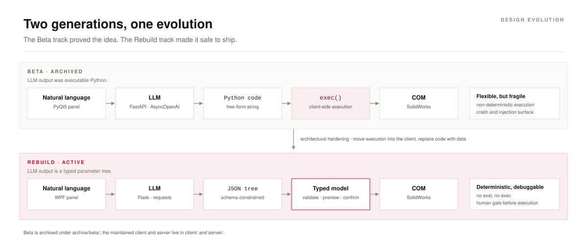
</p>

### JSON parameters instead of generated code

The Beta track let the LLM emit Python code that the client ran with `exec()`. It was flexible and impressive in a demo, but fragile in practice: a hallucinated API call could crash SolidWorks, error recovery was nearly impossible, and debugging meant reading code nobody wrote.

The Rebuild track treats the LLM as a **schema-driven parameterizer**. The model fills a small, typed template. The C# client owns execution. If the JSON is valid and the parameters pass validation, the feature calls are well-formed. Otherwise, the server rejects the response before SolidWorks is touched. There is no `exec()` and no code-injection surface in the release client.

### A thin client and a portable server

1. **Keys stay server-side by default.** Embedding an LLM API key in a client-side macro is not acceptable. When a user chooses to bring their own key, the add-in stores it locally with Windows DPAPI and forwards it to their Vulcan server only for the duration of a request.
2. **Prompts iterate quickly.** Updating a server prompt takes seconds; shipping a new add-in requires a rebuild and reinstall.
3. **The server can run headless.** That keeps the door open for batch processing, CI checks, and a future web front end.

### A domain prompt, not a generic one

General models fail at CAD not because they lack intelligence, but because they lack context. They do not know the difference between a front plane and a top plane, or that a cut's Z coordinate must fall inside the base thickness.

Vulcan supplies that context through [`system_prompt.py`](server/prompts/system_prompt.py): plane-to-axis mappings, feature schemas, shape-specific fields, output discipline, and an anti-overlap rule for multi-feature models.

### API first, UI fallback second

SolidWorks interop is version-sensitive. The modeler calls the native feature APIs directly, including `FeatureExtrusion3`, `FeatureCut4`, `FeatureRevolve`, `FeatureFillet3`, and `InsertFeatureChamfer`. If an extrusion or cut call fails, the fallback activates `RunCommand` and fills the native feature panel with simulated keystrokes.

The fallback is pragmatic, not elegant. Keep SolidWorks focused while a model is generated, and treat a fallback that runs often as a signal to update the interop parameters.

## Prompt engineering

The prompts live in [`server/prompts/`](server/prompts/) and are versioned with `PROMPT_VERSION = "3.0.0"`. Chinese, English, and French prompts are native, not translations at runtime; the server selects one from an optional `language` field (`zh`, `en`, or `fr`) or detects it from the request text. Each prompt encodes five things:

1. **Output discipline.** JSON only — no markdown, no prose, no code fences.
2. **Coordinate rules.** Per-plane axis mappings, with a worked example for a 200 × 100 × 20 base and four holes.
3. **Feature schema.** Required and optional fields for `extrude`, `cut`, `revolve`, `fillet`, and `chamfer`, plus shape-specific parameters.
4. **Anti-overlap constraint.** Multiple identical features must use distinct coordinates; never stack them at the origin.
5. **Plane vocabulary.** Each prompt emits the plane names its language resolves on any SolidWorks UI: Chinese `前视基准面` / `上视基准面` / `右视基准面`, English `front` / `top` / `right`, and French `front` / `dessus` / `droite`.

The prompt is deliberately separate from business logic so it can be iterated without touching the server. The model call uses a low temperature because the task rewards consistency, not creativity.

## Quick start

### Prerequisites

| Component | Requirement |
|---|---|
| Server | Python 3.10–3.11 and an OpenAI-compatible API key |
| Client | Windows 10/11, SolidWorks 2025 (tested), .NET Framework 4.8 |
| Build tools | Visual Studio 2022 with the .NET desktop workload |
| Network | The client must reach the server; the server must reach the LLM provider |

### 1. Clone the repository

```bash
git clone https://github.com/Robusr/Vulcan.git
cd Vulcan
```

### 2. Start the server

```bash
cd server

python -m venv venv
source venv/bin/activate   # Windows: venv\Scripts\activate

pip install -r requirements.txt
cp .env.example .env
# Edit .env: provider key, base URL, and model name

python app.py
# → http://127.0.0.1:5000
```

The server binds `127.0.0.1:5000` by default and keeps debug mode off unless `FLASK_ENV=development`. Set `HOST=0.0.0.0` only behind a trusted reverse proxy, and set `VULCAN_API_TOKEN` before exposing the server.

### 3. Or run it with Docker

```bash
cd server
docker build -t vulcan-server .
docker run --rm -p 5000:5000 --env-file .env vulcan-server
```

### 4. Verify the API

```bash
curl -s http://127.0.0.1:5000/api/v1/generate \
  -H "Content-Type: application/json" \
  -d '{"prompt":"前视基准面拉伸200x100x20底座，四角各打一个直径10mm通孔"}'
```

The response is the feature tree itself, not a wrapper. If `VULCAN_API_TOKEN` is set, add `-H "Authorization: Bearer $VULCAN_API_TOKEN"`. The first request may take a few seconds while the model runs.

### 5. Install or build the client

**Option A — prebuilt installer.** Prebuilt installers can be distributed through GitHub Releases, or built locally. Run `build_installer.ps1` after building `Release | x64`; it stages the payload in `dist/` and produces `Vulcan Setup/Output/Vulcan-Setup-1.2.1.exe`. The installer requests elevation, registers the x64 add-in with `RegAsm` silently, and leaves no console window open. After it finishes, start SolidWorks and configure the client in the add-in: click **设置** in the top-right corner of the Vulcan panel and enter the server URL, an optional shared token, and, if you want to use your own provider key, the LLM API key, base URL, and model. Settings are stored in `%APPDATA%\Vulcan\settings.json` with the secrets encrypted by Windows DPAPI.

**Option B — build from source.**

1. Open `client/Vulcan.SolidWorksClient/Vulcan.SolidWorksClient.sln` in Visual Studio 2022.
2. Restore NuGet packages (the client uses `Newtonsoft.Json`).
3. The project references the SolidWorks interop assemblies in `ReferenceDLL/`. Replace those files if your SolidWorks version differs.
4. Build and register, then open the **设置** dialog and enter your server URL, for example `https://vulcan.example.com`, plus `VULCAN_API_TOKEN` if the server requires one. The equivalent Windows environment variables (`VULCAN_SERVER_URL`, `VULCAN_API_TOKEN`) still work and act as a fallback when the settings dialog is empty.
5. Build `Release | x64`. SolidWorks is 64-bit; do not ship an x86 build.
6. Run `build_installer.ps1` to stage the payload, then execute `dist\install.bat` from an elevated command prompt, or run `RegAsm.exe Vulcan.SolidWorksClient.dll /codebase` directly.
7. Restart SolidWorks and open a Part document. The `Vulcan AI` ribbon tab should appear.

### 6. Generate your first model

Open the Vulcan panel and try one of these:

```text
前视基准面拉伸200x100x20底座，四角各打一个直径10mm通孔
```

```text
Create a 200 x 100 x 20 mm base on the front plane, with a 10 mm through hole at each corner.
```

```text
Créez une base de 200 x 100 x 20 mm sur le plan de face, avec un trou traversant de 10 mm à chaque coin.
```

Click **开始生成** (Generate). The add-in fetches a feature tree and opens an editable JSON preview. Review the parameters, adjust anything the model got wrong, and click **执行建模** (Execute). Only then does the modeler build the features, zoom to fit, and leave the model as an editable feature tree. Cancelling the preview leaves SolidWorks untouched.

## Operation walkthrough

This section maps every entity you touch, from the installer to the feature tree.

### 1. Install

1. Run `Vulcan-Setup-1.2.1.exe`. Accept the administrator prompt, read the GPLv3 page, and keep the default `{autopf}\Vulcan` folder.
2. The installer copies the add-in, its dependencies, the icon set, and `install.bat` / `uninstall.bat`, then runs `install.bat /quiet` to register the x64 add-in with `RegAsm`.
3. Alternatively, extract `Vulcan-1.2.1-portable.zip` and run `install.bat` as administrator.
4. Restart SolidWorks.

### 2. Open the panel

| Entity | Where | What it does |
|---|---|---|
| `Vulcan AI` ribbon tab | CommandManager, last tab | Hosts the **打开AI生成窗口** command |
| `AI生成` toolbar button | Left toolbar | Opens the same modal panel |
| `Vulcan AI` window | Center of SolidWorks | Resizable 680 × 520 prompt panel with examples and a status banner |

### 3. Configure the server

Click the gear button (top-right of the panel). The dialog contains two grouped sections, six fields, and four buttons.

| Field | Meaning |
|---|---|
| 服务端地址 | Vulcan server URL; default `http://127.0.0.1:5000` |
| 服务端 Token | Matches `VULCAN_API_TOKEN` when the server requires a bearer token |
| LLM API Key | Your own provider key (BYOK); leave empty to use the server's key |
| LLM Base URL | OpenAI-compatible base URL for your provider |
| 模型名称 | Model name, for example `gpt-4o-mini` |

| Button | Behavior |
|---|---|
| 测试连接 | Calls `GET /health` and prints the response in the dialog |
| 打开日志目录 | Opens `Desktop\Vulcan_Logs` |
| 取消 | Closes without saving |
| 保存 | Writes `%APPDATA%\Vulcan\settings.json`; the token and BYOK key are DPAPI-encrypted |

### 4. Describe the part

Type a request into the white input card, for example `在前视基准面拉伸一个直径40，高度60的圆柱体`. The placeholder disappears on focus. **开始生成** sends `POST /api/v1/generate`; the status dot stays green while idle.

### 5. Review and edit the JSON

The **检查并编辑建模参数** window shows the original request, a JSON editor with live validation, and the 格式化, 恢复原始, 执行建模, and 取消 buttons.

| Entity | Behavior |
|---|---|
| JSON editor | Dark editor with live validation; must keep `feature_type` (or `features[]`) and a valid `params` object |
| 执行建模 | Validates the edited JSON, closes the preview, and runs the modeler |
| 取消 | Closes the preview; the document is untouched |

### 6. Inspect the result

The modeler creates native features (for the example: `凸台-拉伸1` plus its sketch). A **模型生成完成!** dialog confirms success. Client logs are written to `Vulcan_Logs\log_YYYYMMDD.txt`; server logs to `vulcan_server.log`.

## Unreleased

- Added native `linear_pattern`, `circular_pattern`, `mirror`, `shell`, `draft`, `sweep`, `loft`, and `rib` features.
- Raised the prompt contract to `PROMPT_VERSION = "2.4.0"` and updated the English, Chinese, and French documentation.
- Refreshed the add-in UI with a shared theme, a resizable prompt panel with examples, a dark JSON editor with live validation, and a grouped settings dialog with masked secrets.
- Edited JSON is now validated client-side against the same rules as the server before SolidWorks is touched.
- Fixed draft `propagation`, blind-cut fallback, four-hole coordinate heuristics, part-document checks, shell verification, repeated-run feature naming, and the second direction of linear patterns.
- The server now rejects responses that mix `feature_type` with `features`, and validates simple geometry against the base block: hole bounds, fillet and chamfer size, shell thickness, and pattern extent.
- The client reports how many features were created when a run aborts, and Release builds no longer require an elevated COM registration step.
- Rate-limit state is bounded, an optional trusted-proxy mode fixes client IPs behind a reverse proxy, and CI now runs ruff, Black, mypy, and the client validator tests.
- Sketches now carry driving dimensions: circle diameter, rectangle length and width, polygon side length, slot radius and center-distance, and line length for rib and sweep paths. Profile position still comes from coordinates, and ellipse profiles stay geometry-only.
- Verified against SolidWorks 2025 SP0 with an automated COM smoke run (`tools/SolidWorksVerify`): requested sizes appear as dimensions and editing a diameter rebuilds the body.
- Added `counterbore`, `countersink`, and `hole_array` hole features, plus `insert_component` for assemblies and `note` for drawing annotations.
- Added native English and French prompts, an optional `language` field, provider adapters for `openai` and `anthropic`, and an SSE streaming endpoint with client-side progress.
- Extracted `ModelingEngine` behind an `IFeatureBackend` seam so client CI runs sequencing, seed resolution, and partial-failure checks with a fake backend.
- Added a task pane panel; the ribbon command opens the pane and falls back to the modal window when the pane is unavailable.
- Fixed blind cuts by using bidirectional `FeatureCut4` parameters with an opposite-direction retry.
- The task pane hosts the WPF panel through `SetParent` and stays interactive; the ribbon command falls back to the modal panel if hosting fails.
- During a modeling run the client temporarily disables SolidWorks’ dimension input dialog and restores the preference afterwards, so sketch dimensions are added without manual confirmation.

## What's new in 1.2.1

- Branded multi-size icons on the ribbon, toolbar, and command buttons.
- Restyled prompt panel, settings dialog, and editable JSON preview.
- GPLv3 installer with a license page, modern wizard, silent registration, and uninstall cleanup.
- Bring-your-own-key settings stored with Windows DPAPI.
- Captioned install, workflow, and uninstall GIFs in this README.

## Install, upgrade, and uninstall

### Requirements

| Component | Requirement |
|---|---|
| Operating system | Windows 10/11, x64 |
| CAD | SolidWorks 2025 (tested); older releases may need the UI fallback |
| Runtime | .NET Framework 4.8 |
| Server | A running Vulcan server, local or remote |

### Install

<p align="center">
  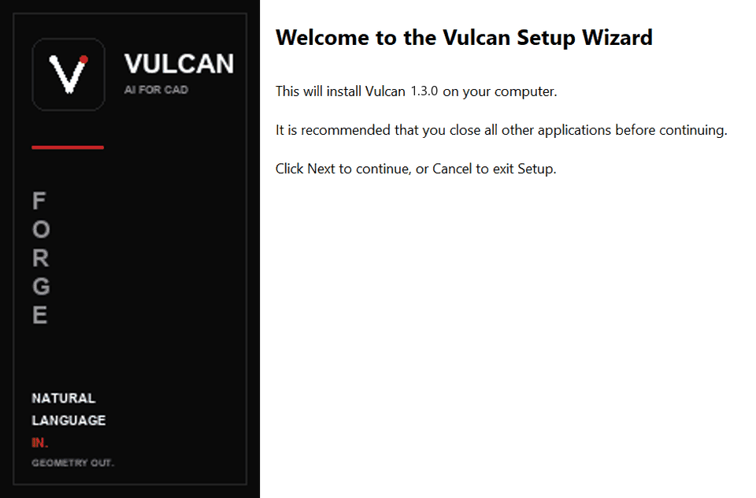
</p>

1. Run `Vulcan-Setup-1.2.1.exe` and approve the administrator prompt.
2. Accept the GPLv3 license and keep the default `{autopf}\Vulcan` folder, or choose another.
3. The installer copies the add-in, dependencies, and icons, then runs `install.bat /quiet` to register the x64 add-in with `RegAsm`.
4. Restart SolidWorks; the `Vulcan AI` tab and the `AI生成` toolbar button are available.

Silent install:

```bat
Vulcan-Setup-1.2.1.exe /VERYSILENT /SUPPRESSMSGBOXES /NORESTART
```

Portable alternative: extract `Vulcan-1.2.1-portable.zip` and run `install.bat` as administrator.

### Upgrade

Run a newer installer over the existing installation. The installer keeps the previous folder and re-registers the add-in; `%APPDATA%\Vulcan\settings.json` is not touched, so server URL, token, and BYOK fields survive the upgrade.

### Uninstall

<p align="center">
  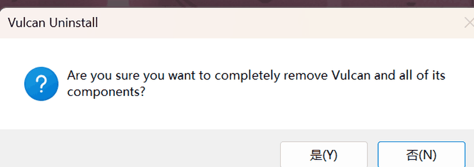
</p>

1. Open **Settings → Apps → Installed apps**, find **Vulcan AI For SolidWorks**, and choose **Uninstall**. You can also run `C:\Program Files\Vulcan\unins000.exe`.
2. Confirm the removal. The uninstaller runs `uninstall.bat /quiet`, unregisters the add-in, deletes the install folder, and removes the SolidWorks add-in keys.
3. Restart SolidWorks. Settings in `%APPDATA%\Vulcan` and logs in `Desktop\Vulcan_Logs` are intentionally kept; delete them manually for a full wipe.

Silent uninstall:

```bat
"C:\Program Files\Vulcan\unins000.exe" /VERYSILENT /SUPPRESSMSGBOXES /NORESTART
```

## Testing

The server suite uses Flask's test client and a mocked LLM client. The client has a dependency-free validator test runner, and the build and installer are covered by the GitHub Actions workflows.

```bash
cd server
pip install -r requirements.txt -r requirements-dev.txt
pytest
pip-audit -r requirements.txt
```

```bat
msbuild client\tests\Vulcan.Client.Tests\Vulcan.Client.Tests.csproj /p:Configuration=Release /p:Platform=x64
client\tests\Vulcan.Client.Tests\bin\x64\Release\Vulcan.Client.Tests.exe
```

An optional SolidWorks smoke run exercises the real modeler. It requires SolidWorks 2025 on the machine, closes the documents it creates, and restores the prompt preferences it changes:

```bat
msbuild tools\SolidWorksVerify\SwVerify.csproj /p:Configuration=Release /p:Platform=x64
tools\SolidWorksVerify\bin\SwVerify.exe
```

## Configuration

### Server environment

```env
QINIU_API_KEY="sk-xxxxxxxxxxxxxxxx"
QINIU_BASE_URL="https://api.openai.com/v1"
QINIU_MODEL="gpt-4o-mini"
LLM_PROVIDER="openai"

HOST="127.0.0.1"
PORT="5000"
FLASK_ENV="production"
VULCAN_API_TOKEN=""
VULCAN_RATE_LIMIT_PER_MINUTE="60"
VULCAN_RATE_LIMIT_MAX_KEYS="10000"
VULCAN_TRUST_PROXY="false"
MAX_PROMPT_LENGTH="4000"
LLM_TIMEOUT="30"
LOG_LEVEL="INFO"
LOG_FILE="vulcan_server.log"
```

The `QINIU_*` names are historical: the first deployment used Qiniu Cloud. The client is OpenAI-compatible, so the names only matter to `config.py`.

| Variable | Default | Purpose |
|---|---|---|
| `QINIU_API_KEY` | none | Provider API key |
| `QINIU_BASE_URL` | none | OpenAI-compatible base URL |
| `QINIU_MODEL` | `gpt-oss-120b` | Model name |
| `LLM_PROVIDER` | `openai` | Provider family: `openai` (chat completions) or `anthropic` (Messages API) |
| `HOST` | `127.0.0.1` | Bind address; use `0.0.0.0` only behind a trusted reverse proxy |
| `PORT` | `5000` | Server port |
| `FLASK_ENV` | `production` | Set to `development` to enable Flask debug mode |
| `VULCAN_API_TOKEN` | none | Optional bearer token required from clients |
| `VULCAN_RATE_LIMIT_PER_MINUTE` | `60` | Per-IP limit for the generate endpoint; `0` disables it |
| `VULCAN_RATE_LIMIT_MAX_KEYS` | `10000` | Upper bound on tracked client keys; oldest keys are evicted first |
| `VULCAN_TRUST_PROXY` | `false` | Trust one reverse-proxy hop for `X-Forwarded-For` and `X-Forwarded-Proto` |
| `MAX_PROMPT_LENGTH` | `4000` | Maximum prompt length in characters |
| `LLM_TIMEOUT` | `30` | Upstream request timeout in seconds |
| `LOG_LEVEL` | `INFO` | Log level; prompts are logged by length only at INFO |
| `LOG_FILE` | `vulcan_server.log` | Rotating log file |

### Provider examples

| Provider | `QINIU_BASE_URL` | Example model |
|---|---|---|
| OpenAI | `https://api.openai.com/v1` | `gpt-4o-mini` |
| DeepSeek | `https://api.deepseek.com/v1` | `deepseek-chat` |
| Qwen (DashScope compatible mode) | `https://dashscope.aliyuncs.com/compatible-mode/v1` | `qwen-plus` |
| Ollama | `http://localhost:11434/v1` | a model served locally |
| vLLM | `http://localhost:8000/v1` | your served model |
| Anthropic | `https://api.anthropic.com/v1` with provider `anthropic` | `claude-opus-5-5` |

Use a model with strong instruction-following and reliable JSON output. Weak models produce the classic failure modes: markdown wrappers, prose before the JSON, or coordinates that overlap.

### Client settings

The add-in is configured in its own dialog: click **设置** in the top-right corner of the Vulcan panel.

| Field | Purpose |
|---|---|
| Server URL | The Vulcan server, for example `https://vulcan.example.com` |
| Server token | Matches `VULCAN_API_TOKEN` when the server requires a bearer token |
| LLM API Key | Your own provider key; leave empty to use the server's key |
| LLM Base URL | OpenAI-compatible base URL for your provider |
| LLM Provider | `openai` or `anthropic`; selects the request shape sent to your provider |
| LLM Model | Model name, for example `gpt-4o-mini` |

The dialog also has **测试连接** (health check), **打开日志目录** (open the client log folder), and **保存**. Settings are written to `%APPDATA%\Vulcan\settings.json`; `ServerToken` and `LlmApiKey` are encrypted with Windows DPAPI for the current user, so the file is not portable across machines or accounts and must never be committed.

Resolution order for the server URL is: explicit constructor argument → settings dialog → `VULCAN_SERVER_URL` → `http://127.0.0.1:5000`. The token follows the same order. The LLM overrides are sent to the server as `X-LLM-API-Key`, `X-LLM-Base-URL`, and `X-LLM-Model`; empty fields are omitted, so the server falls back to its own `QINIU_*` configuration.

The environment variables still work for scripted or shared deployments:

```bat
setx VULCAN_SERVER_URL "https://vulcan.example.com"
setx VULCAN_API_TOKEN "your-shared-token"
```

Non-loopback hosts must use HTTPS unless `VULCAN_ALLOW_INSECURE=true` is set for a trusted LAN.

### Tuning

- `temperature 0.05`, `top_p 0.95`, `max_tokens 2048` in [`llm_client.py`](server/services/llm_client.py) control the model call.
- `LLM_TIMEOUT = 30` in [`config.py`](server/config.py) controls the server-side request timeout.
- `ApiClient` uses a 60-second client timeout so the server can wait out a slow model response. Keep it above `LLM_TIMEOUT`.

## API reference

### `POST /api/v1/generate`

Request:

```json
{
  "prompt": "前视基准面拉伸200x100x20底座，四角各打一个直径10mm通孔"
}
```

Success — `200 OK` with the feature tree:

```json
{
  "model_name": "Mounting plate",
  "features": [
    {
      "feature_type": "extrude",
      "name": "Base",
      "params": {
        "plane": "前视基准面",
        "shape": "rectangle",
        "length": 200,
        "width": 100,
        "depth": 20
      }
    }
  ]
}
```

Errors use a small envelope:

```json
{
  "message": "缺少必要字段: prompt",
  "status": "error"
}
```

| Status | Condition |
|---|---|
| `400` | Missing, non-string, too long, or empty `prompt`, no valid feature envelope, or invalid feature parameters |
| `401` | `VULCAN_API_TOKEN` is set and the bearer token is missing or wrong |
| `429` | The per-IP rate limit was exceeded |
| `503` | The LLM provider is unreachable or the request timed out |
| `500` | The LLM response could not be parsed, or an unknown server error occurred |

**Bring-your-own-key headers (optional).** The add-in can override the server's provider for a single request:

| Header | Purpose |
|---|---|
| `X-LLM-API-Key` | Provider key, used for this request only |
| `X-LLM-Base-URL` | OpenAI-compatible base URL; ignored when `VULCAN_ALLOW_CUSTOM_LLM_BASE_URL=false` |
| `X-LLM-Model` | Model name |

Omitted headers fall back to `QINIU_*`. Values are length-limited, the base URL must use `http` or `https`, and neither keys nor prompts are written to the server log.

### `POST /api/v1/generate/stream`

Same request body and headers as `/api/v1/generate`. The response is `text/event-stream`; each event is a `data:` line containing one JSON object.

| Event | Payload |
|---|---|
| `delta` | `{"type":"delta","text":"..."}` for each provider text chunk |
| `result` | `{"type":"result","data":{...}}` with the validated feature tree |
| `error` | `{"type":"error","message":"...","status":400}` when the request or model output is invalid |

The server accumulates the text, parses the JSON, and applies the same envelope and feature validation as the non-streaming endpoint.

**Security.** The server supports an optional bearer token and per-IP rate limiting. It does not terminate TLS and has no user accounts. Keep `HOST=127.0.0.1` or put it behind a TLS reverse proxy, set `VULCAN_API_TOKEN`, and never enable Flask debug mode in production.

## Project structure

```text
Vulcan/
├── README.md                     # English (default)
├── README.zh-CN.md               # 简体中文
├── README.fr.md                  # Français
├── SECURITY.md                   # Security policy and key rotation
├── pyproject.toml                # Ruff, Black, and mypy configuration
├── client/                       # Active C# / WPF client
│   └── Vulcan.SolidWorksClient/
│       ├── Core/                 #   SwAddIn — COM registration and lifecycle
│       ├── Models/               #   ModelData — request/response types
│       ├── Services/             #   ApiClient, SwModeler, ModelingEngine, validator
│       ├── UI/                   #   MainWindow, task pane, SettingsWindow, PreviewWindow
│       ├── ReferenceDLL/         #   SolidWorks interop assemblies
│       ├── Vulcan Setup/         #   Inno Setup installer
│       └── packaging/            #   install/uninstall scripts and build_installer.ps1
├── client/tests/                 #   Dependency-free validator test runner (CI)
│   └── Vulcan.Client.Tests/
├── server/                       # Active Flask server
│   ├── app.py                    #   Flask entry point
│   ├── config.py                 #   Environment configuration
│   ├── .env.example              #   Provider, auth, and server template
│   ├── Dockerfile                #   python:3.11-slim + gunicorn image
│   ├── prompts/                  #   Versioned zh/en/fr prompts
│   ├── services/                 #   LLM client and feature validator
│   ├── tests/                    #   pytest suite
│   └── utils/                    #   Logging, rate limiting, exceptions
├── archive/                      # Historical code kept for reference
│   └── beta/                     #   Legacy code-generation track
│       ├── client-csharp-beta/   #     Early command-group / ribbon prototype
│       ├── client-python-beta/   #     PyQt5 client with exec() execution
│       └── server-python-beta/   #     FastAPI + AsyncOpenAI server
├── docs/
│   └── assets/                   # Vector figures used by all three READMEs
├── scripts/                      # Maintenance scripts
└── tools/                        # Documentation and demo tooling
```

**Repository notes.** The maintained client compiles `Core/SwAddIn.cs`. The beta track is archived under `archive/beta/` and is not maintained. Build artifacts, logs, `.env` files, and the installer payload are ignored by git.

## Compatibility and current scope

| Area | Status |
|---|---|
| SolidWorks | Built and tested against SolidWorks 2025 (`FeatureExtrusion3`, `FeatureCut4`, `FeatureRevolve`, `FeatureFillet3`, `InsertFeatureChamfer`). Older releases may need parameter updates or the UI fallback; they are not part of the tested matrix. |
| Client platform | Windows only, x64, .NET Framework 4.8. |
| Server platform | Python 3.10–3.11; local, Docker, or headless. |
| Feature types | `extrude`, `cut`, `revolve`, `fillet`, `chamfer`, `linear_pattern`, `circular_pattern`, `mirror`, `shell`, `draft`, `sweep`, `loft`, `rib`, `counterbore`, `countersink`, `hole_array`, `note`, and `insert_component` are implemented. |
| Planes | The modeler routes front, top, and right datum planes and resolves Chinese, English, and French plane names. |
| Validation | The server checks the envelope and validates feature parameters; envelope deserialization and field defaults live in the C# client. |
| Authentication | Optional bearer token (`VULCAN_API_TOKEN`) and per-IP rate limiting. TLS and user accounts still belong in a reverse proxy. |
| LLM quality | Latency and correctness depend on the provider. Use a strong instruction-following model. |

## Troubleshooting

| Symptom | Likely cause | Fix |
|---|---|---|
| `Vulcan AI` tab does not appear | The add-in is not registered, or the build is x86 | Build the x64 Release configuration, run `install.bat` or `RegAsm` as administrator, restart SolidWorks |
| "Target machine actively refused connection" | Server is not running, or `VULCAN_SERVER_URL` is wrong | Start `python app.py`; check the host and port; open the firewall |
| No active document | SolidWorks has no Part open | Create or open a Part document, then generate again |
| Sketch appears, extrusion fails | Interop version mismatch or a stale SolidWorks state | Check `Desktop/Vulcan_Logs`; update `FeatureExtrusion3` parameters; keep SolidWorks focused |
| Fillet or chamfer fails | The radius or distance is too large, or the body has no solid edges | Reduce the value, rebuild the base, and inspect `Vulcan_Logs` |
| Revolve fails | The profile lies on or crosses the revolution axis | Move `center_x` or `center_y` away from the axis |
| Server tests fail after install | Development dependencies are missing | Run `pip install -r requirements.txt -r requirements-dev.txt` |
| LLM returns an empty or malformed response | The model ignored the JSON contract | Switch to a stronger model, lower `temperature`, inspect `vulcan_server.log` |
| Request times out | The model is slower than 30 seconds | Raise `LLM_TIMEOUT` and the `ApiClient` timeout together |
| Chinese or French request is misunderstood | The model lacks multilingual engineering vocabulary | Use a multilingual model; the system prompt is Chinese |
| Build fails on SolidWorks references | `ReferenceDLL/` does not match your SolidWorks version | Replace the interop assemblies in `ReferenceDLL/` with matching ones |
| Installer registration fails | SolidWorks is running, or the shell is not elevated | Close SolidWorks and rerun the installer as administrator |
| Settings dialog cannot reach the server | Wrong URL, server down, or a token mismatch | Use **测试连接** in the dialog; check `VULCAN_SERVER_URL` and the server console |
| Provider returns `401` or `403` | The BYOK key is invalid, expired, or lacks access to the model | Re-enter the key in **设置**; check the provider console |
| Preview rejects the edited JSON | The edit no longer matches the contract | Keep `feature_type` (or `features`) and a `params` object; see the JSON contract |
| Settings do not persist | `%APPDATA%\Vulcan` is not writable, or the Windows profile changed | Check folder permissions; the secrets are DPAPI-encrypted per Windows user |
| Ribbon missing after reinstalling | An old registration still points at the previous DLL path | Run `uninstall.bat` as administrator, then reinstall |
| Model appears but holes are in the wrong place | The plane or coordinate convention does not match the request | Inspect the returned JSON; the four-corner heuristic assumes front-plane X/Y |

Server logs are written to `vulcan_server.log` in the working directory, rotated at 5 MB, and ignored by git. Prompts are logged by length at INFO level; set `LOG_LEVEL=DEBUG` to include full content locally. Client logs are written to `Vulcan_Logs/log_YYYYMMDD.txt` on the desktop.

## Roadmap

- [x] General datum-plane routing.
- [x] Revolve, fillet, and chamfer features.
- [x] Sweep, loft, and rib features.
- [x] Linear/circular patterns and mirroring.
- [x] Hole Wizard and hole-array enhancements.
- [x] Native English and French system prompts, not only multilingual model behavior.
- [x] Provider adapters and streaming responses.
- [x] Optional bearer-token authentication and per-IP rate limiting.
- [x] Bring-your-own-key provider settings with local DPAPI storage.
- [x] Editable JSON preview before execution.
- [x] Self-elevating, quiet install and uninstall scripts.
- [x] Prompt regression tests and a Python CI workflow.
- [x] A mocked COM layer for client CI.
- [x] A task-pane UI instead of a modal panel.
- [x] Assembly-level operations and drawing annotations.

## Contributing

Pull requests are welcome. For significant changes, open an issue first so the approach can be discussed.

Good places to help:

- **Features:** add new feature types and shape handlers in `SwModeler`.
- **Providers:** abstract the LLM client further and add provider-specific adapters.
- **Testing:** extend the Python tests and build a COM abstraction that can run in CI.
- **Documentation:** improve the three READMEs or add localized screenshots and examples.

Before opening a pull request, run `pytest` and `pip-audit`, exercise at least one prompt end to end, and keep `.env`, logs, and build artifacts out of the commit. The project is GPLv3; contributions are accepted under the same license.

## License

Distributed under the **GNU General Public License v3.0**. Derivative works must also be open-sourced under GPLv3. See [LICENSE](LICENSE) for the full text.

---

<p align="center">
  <sub>Built by <a href="https://github.com/Robusr">Robusr</a> — because learning SolidWorks shouldn't require a 200-page manual.</sub>
</p>
