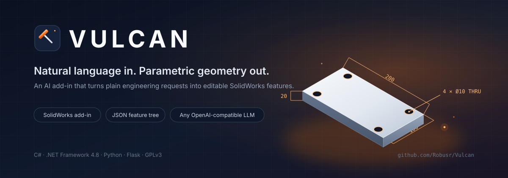
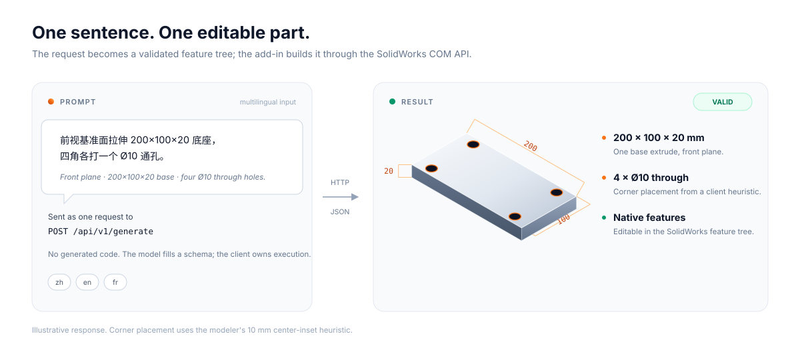
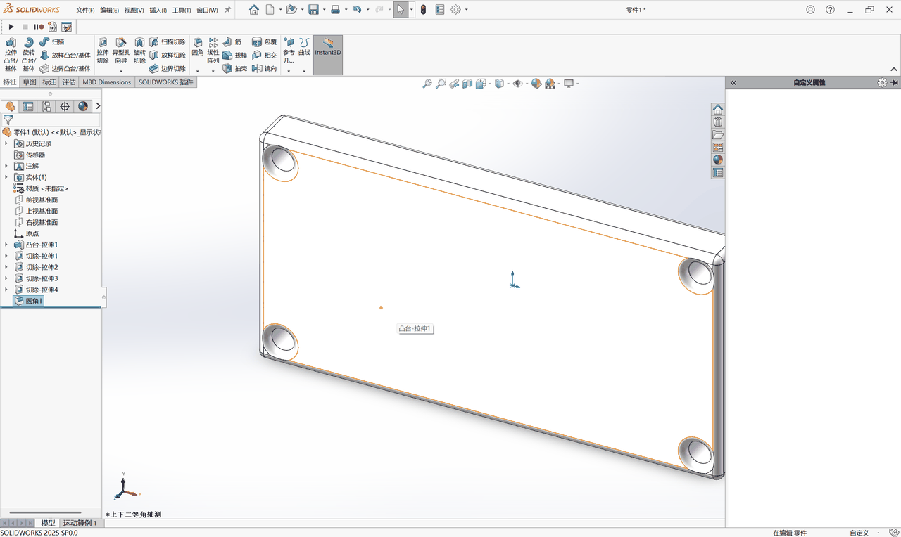
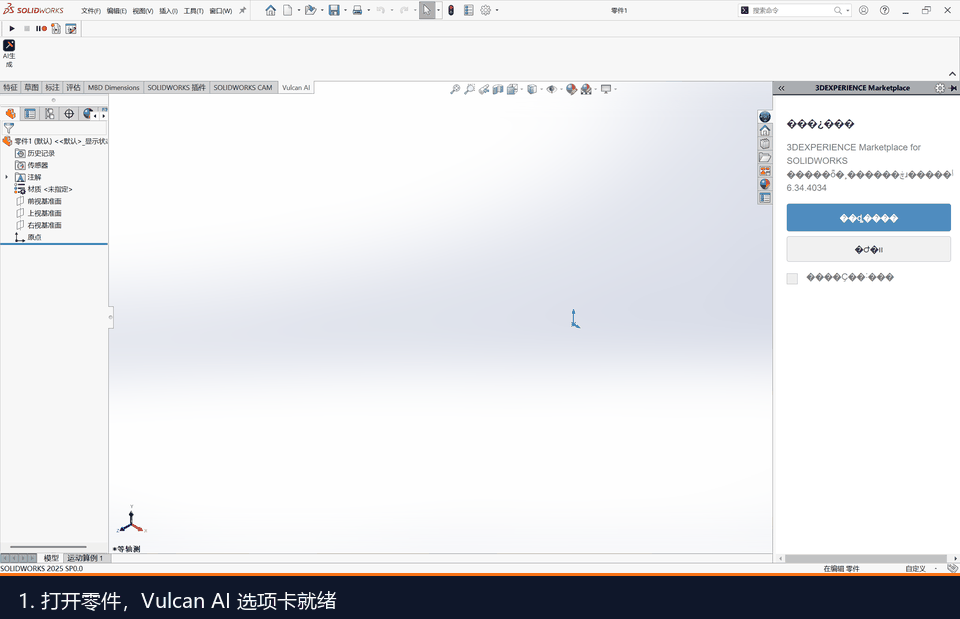
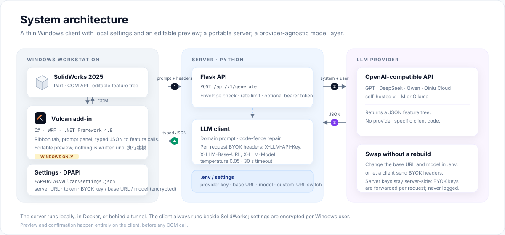
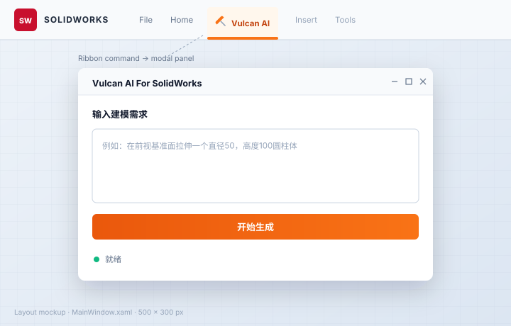
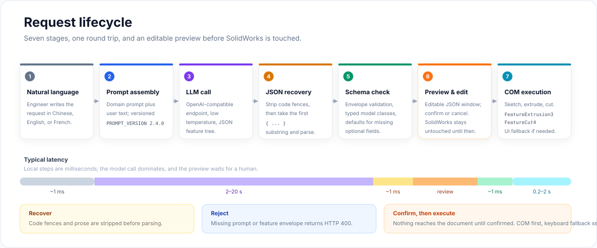
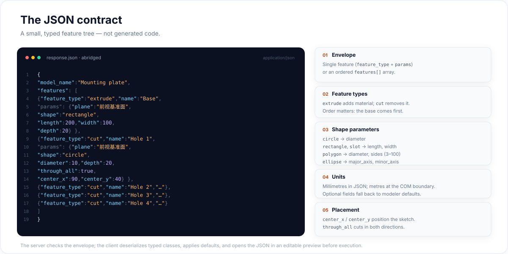
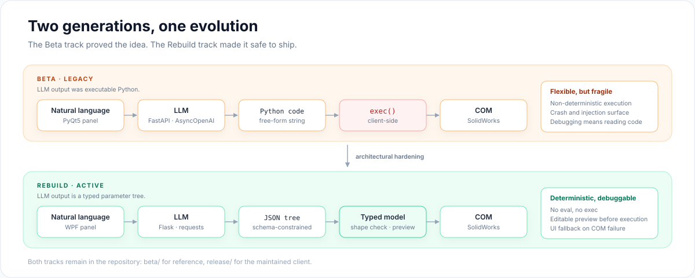

<p align="center">
  
</p>

<h1 align="center">Vulcan</h1>

<p align="center">
  <strong>Natural language in. Parametric SolidWorks geometry out.</strong><br>
  An AI add-in that turns a plain engineering request into editable SolidWorks features.
</p>

<p align="center">
  <a href="https://github.com/Robusr/Vulcan/stargazers"></a>
  <a href="https://github.com/Robusr/Vulcan/network/members"></a>
  
  
  
  
  <a href="LICENSE"></a>
</p>

<p align="center">
  <a href="README.md"><strong>English</strong></a> ·
  <a href="README.zh-CN.md">简体中文</a> ·
  <a href="README.fr.md">Français</a>
</p>

<p align="center">
  <a href="#why-vulcan">Why Vulcan</a> ·
  <a href="#what-it-does">What it does</a> ·
  <a href="#capabilities">Capabilities</a> ·
  <a href="#system-architecture">Architecture</a> ·
  <a href="#the-json-contract">JSON contract</a> ·
  <a href="#quick-start">Quick start</a> ·
  <a href="#testing">Testing</a> ·
  <a href="#roadmap">Roadmap</a>
</p>

<p align="center">
  
</p>

## Why Vulcan

SolidWorks is precise, powerful, and famously click-heavy. A mounting plate with four holes can take a dozen operations: choose a plane, sketch a rectangle, add dimensions, exit the sketch, extrude, select a face, sketch circles, pattern them, and cut through all.

Vulcan compresses that sequence into one sentence. The name comes from the Roman god of fire and metalworking — the forge where raw material meets deliberate intent. Here the raw material is language, and the intent is a parametric feature tree.

The repository contains two generations of the idea:

- **`beta/`** — the original proof of concept. The LLM generated Python code and the client executed it with `exec()`.
- **`release/`** — the maintained architecture. The LLM returns a typed JSON feature tree and a C# add-in executes it deterministically.

This README focuses on `release/`. The Beta track is kept for reference and for the design story.

## What it does

<p align="center">
  
</p>

<p align="center">
  <sub>Illustrative response. The same contract accepts a base extrude followed by an ordered list of cuts.</sub>
</p>

<p align="center">
  
</p>

<p align="center">
  <sub>Real SolidWorks 2025 output: a 200 × 100 × 20 mm plate with four 10 mm through holes and filleted edges. Captured from the local test harness.</sub>
</p>

<p align="center">
  
</p>

<p align="center">
  <sub>The shipped 1.2.0 workflow: describe the part, review or edit the generated JSON, then let the add-in build native features. Captured from the installed add-in.</sub>
</p>


1. **Describe the part.** Write a request in the add-in panel. Multilingual models handle Chinese, English, and French input; the system prompt itself is written in Chinese.
2. **The model fills a schema.** The server prepends a versioned SolidWorks domain prompt and calls any OpenAI-compatible endpoint. The model returns JSON, not code.
3. **The add-in builds it.** The C# client deserializes the tree, draws sketches, and calls the native SolidWorks feature APIs. The result is a native feature tree you can edit.

## Capabilities

| Capability | What it means |
|---|---|
| Natural-language modeling | One request becomes an ordered feature tree with a base and subsequent features. |
| Native output | Editable SolidWorks features, not a mesh, a macro, or a generated script. |
| Structured contract | A JSON envelope with `extrude`, `cut`, `revolve`, `fillet`, and `chamfer` features; millimetres in, metres at the COM boundary. |
| Shape library | Circle, rectangle, polygon, ellipse, and slot profiles. |
| Feature library | Extrude, cut, revolve, fillet, chamfer, and a hole alias. |
| Hole placement | Explicit `center_x` and `center_y`, `through_all`, and a four-corner heuristic that receives the original prompt in Chinese or English. |
| Provider freedom | OpenAI, DeepSeek, Qwen, Qiniu Cloud, vLLM, Ollama, or any compatible endpoint. |
| Portable server | Runs locally, in Docker, or behind a tunnel; only the client needs Windows. |
| Debuggable pipeline | No `exec()` in the release track; each stage is logged and typed. |
| API-first execution | Native feature APIs first. Extrusion and cut failures fall back to a keyboard-driven native panel. |
| Bring your own key | Set the provider key, base URL, and model in the add-in settings dialog. The key is DPAPI-encrypted on your machine and sent only to your Vulcan server, for the duration of a request. |
| Editable preview | Every response opens in an editable JSON preview. Nothing reaches SolidWorks until you review and confirm the feature tree. |
| Quiet install and uninstall | The installer self-elevates, registers the x64 add-in with `RegAsm`, and uninstalls cleanly without leaving a stale registration behind. |

## System architecture

<p align="center">
  
</p>

| Layer | Stack | Responsibility |
|---|---|---|
| Client | C# / WPF / .NET Framework 4.8 | `Vulcan AI` ribbon tab, prompt panel, JSON envelope handling, COM execution |
| Transport | HTTP REST / JSON | Single endpoint: `POST /api/v1/generate` |
| Server | Python 3.10+ / Flask 3 | Prompt assembly, LLM call, envelope and parameter validation, error mapping |
| Model | OpenAI-compatible API | JSON feature tree generation |
| Deployment | Docker, reverse proxy, or bare metal | Server anywhere; client beside SolidWorks |

The add-in registers a `Vulcan AI` ribbon tab for parts, assemblies, and drawings, plus a toolbar and menu command. The button opens a modal WPF panel; it is not a separate CAD application.

<p align="center">
  
</p>

<p align="center">
  <sub>Layout mockup of the 500 × 300 prompt panel. The shipped UI is Chinese; the panel accepts natural-language requests.</sub>
</p>

## Request lifecycle

<p align="center">
  
</p>

1. **Request.** The add-in sends `{ "prompt": "..." }` to the Flask server.
2. **Prompt assembly.** The server prepends the versioned SolidWorks domain prompt to the user text.
3. **Model call.** Any OpenAI-compatible endpoint returns a JSON feature tree. The default request uses `temperature 0.05`, `top_p 0.95`, `max_tokens 2048`, and a 30-second timeout.
4. **Recovery.** The server strips markdown code fences, then extracts the first `{` through the last `}` before parsing.
5. **Validation.** Flask checks the envelope and validates feature parameters. The C# client deserializes the envelope into typed model classes, then reads parameters from a dictionary and applies modeler defaults.
6. **Execution.** `SwModeler` draws the sketch, selects it, and calls the native feature APIs, including `FeatureExtrusion3`, `FeatureCut4`, `FeatureRevolve`, `FeatureFillet3`, and `InsertFeatureChamfer`. Extrusion and cut failures use a keyboard-driven fallback to the native SolidWorks feature panel.

The model call dominates latency. Everything else is local and usually measured in milliseconds.

## The JSON contract

<p align="center">
  
</p>

### Envelope

A response is either a single feature:

```json
{
  "feature_type": "extrude",
  "name": "Cylinder",
  "params": {
    "plane": "前视基准面",
    "shape": "circle",
    "diameter": 50,
    "depth": 100
  }
}
```

or an ordered multi-feature model:

```json
{
  "model_name": "Mounting plate",
  "features": [
    {
      "feature_type": "extrude",
      "name": "Base",
      "params": {
        "plane": "前视基准面",
        "shape": "rectangle",
        "length": 200,
        "width": 100,
        "depth": 20
      }
    },
    {
      "feature_type": "cut",
      "name": "Hole 1",
      "params": {
        "plane": "前视基准面",
        "shape": "circle",
        "diameter": 10,
        "depth": 20,
        "through_all": true,
        "center_x": 90,
        "center_y": 40
      }
    }
  ]
}
```

One of the four holes is shown. The full response repeats the `cut` feature with the other corner coordinates.

### Feature types

| Type | Purpose | Key parameters |
|---|---|---|
| `extrude` | Creates the base or adds material. | `plane`, `shape`, `depth` |
| `cut` / `hole` | Removes material from the current solid. | `plane`, `shape`, `depth` unless `through_all` |
| `revolve` | Revolves an offset profile around an axis. | `plane`, `shape`, profile dimensions, and `center_x` or `center_y` offset from the axis |
| `fillet` | Rounds every edge of the current solid. | `radius` |
| `chamfer` | Applies an equal-distance chamfer to every edge. | `distance` |

### Feature schema

| Field | Type | Required | Notes |
|---|---|---|---|
| `feature_type` | string | yes | `extrude`, `cut`, `revolve`, `fillet`, or `chamfer` |
| `name` | string | no | Human-readable label used in logs |
| `params.plane` | string | yes for sketch features | Requested datum plane; front, top, and right are supported |
| `params.shape` | string | yes for sketch features | `circle`, `rectangle`, `polygon`, `ellipse`, or `slot` |
| `params.depth` | number | yes for extrude; cuts need it unless `through_all` | Blind depth in millimetres; ignored when `through_all` is true |
| `params.through_all` | boolean | no | Cuts only; defaults to `false`; cuts in both directions when true |
| `params.center_x` | number | cuts in multi-hole models; revolve profiles | Sketch centre on the first sketch axis, in millimetres |
| `params.center_y` | number | cuts in multi-hole models; revolve profiles | Sketch centre on the second sketch axis, in millimetres |
| `params.radius` | number | fillet only | Fillet radius in millimetres; applies to all edges |
| `params.distance` | number | chamfer only | Equal-distance chamfer in millimetres; applies to all edges |
| `params.angle` | number | no | Revolve angle in degrees; defaults to 360 |
| `params.axis` | string | no | Revolve axis, `x` or `y`; defaults to `y` |
| `params.draft_angle` | number | no | Draft angle in degrees for extrude/cut |

### Shape parameters

| Shape | Required fields | Notes |
|---|---|---|
| `circle` | `diameter` | Millimetres |
| `rectangle` | `length`, `width` | Centred on `center_x`, `center_y` |
| `polygon` | `diameter`, `sides` | `sides` is clamped to 3–100 |
| `ellipse` | `major_axis`, `minor_axis` | Millimetres |
| `slot` | `length`, `width` | Straight slot; width is the end diameter |

Additional feature parameters:

- **`revolve`:** requires a sketch profile offset from the revolution axis. Set `center_x` or `center_y` to a non-zero value, and optionally set `axis` to `x` or `y` and `angle` to a value from 1 to 360 degrees.
- **`fillet`:** requires `radius`; applies a constant-radius fillet to all edges of the current solid.
- **`chamfer`:** requires `distance`; applies an equal-distance chamfer to all edges of the current solid.
- **`draft_angle`:** optional on `extrude` and `cut`, in degrees from -89 to 89.

### Coordinates and units

- **Front plane:** sketch axes are X and Y; `center_x` maps to X and `center_y` to Y.
- **Top plane:** sketch axes are X and Z; `center_y` maps to Z and must fall inside the base thickness.
- **Right plane:** sketch axes are Y and Z; `center_x` maps to Y and `center_y` to Z.
- **Multi-feature models:** read the base `length`, `width`, and `depth` first, then compute later coordinates. Never place several identical features at `(0, 0)`.
- **Units:** every dimension in the JSON is millimetres. The modeler converts to metres at the COM boundary.

### Implementation note

The release modeler routes sketches to the requested datum plane and resolves front, top, and right planes on Chinese, English, and French UIs. For a four-corner request, the client also has a heuristic that places cuts at `±(length / 2 − 10)` and `±(width / 2 − 10)` in front-plane X/Y when the prompt explicitly asks for corner holes in Chinese or English.

## Design decisions

<p align="center">
  
</p>

### JSON parameters instead of generated code

The Beta track let the LLM emit Python code that the client ran with `exec()`. It was flexible and impressive in a demo, but fragile in practice: a hallucinated API call could crash SolidWorks, error recovery was nearly impossible, and debugging meant reading code nobody wrote.

The Rebuild track treats the LLM as a **schema-driven parameterizer**. The model fills a small, typed template. The C# client owns execution. If the JSON is valid and the parameters pass validation, the feature calls are well-formed. Otherwise, the server rejects the response before SolidWorks is touched. There is no `exec()` and no code-injection surface in the release client.

### A thin client and a portable server

1. **Keys stay server-side by default.** Embedding an LLM API key in a client-side macro is not acceptable. When a user chooses to bring their own key, the add-in stores it locally with Windows DPAPI and forwards it to their Vulcan server only for the duration of a request.
2. **Prompts iterate quickly.** Updating a server prompt takes seconds; shipping a new add-in requires a rebuild and reinstall.
3. **The server can run headless.** That keeps the door open for batch processing, CI checks, and a future web front end.

### A domain prompt, not a generic one

General models fail at CAD not because they lack intelligence, but because they lack context. They do not know the difference between a front plane and a top plane, or that a cut's Z coordinate must fall inside the base thickness.

Vulcan supplies that context through [`system_prompt.py`](release/server/prompts/system_prompt.py): plane-to-axis mappings, feature schemas, shape-specific fields, output discipline, and an anti-overlap rule for multi-feature models.

### API first, UI fallback second

SolidWorks interop is version-sensitive. The modeler calls the native feature APIs directly, including `FeatureExtrusion3`, `FeatureCut4`, `FeatureRevolve`, `FeatureFillet3`, and `InsertFeatureChamfer`. If an extrusion or cut call fails, the fallback activates `RunCommand` and fills the native feature panel with simulated keystrokes.

The fallback is pragmatic, not elegant. Keep SolidWorks focused while a model is generated, and treat a fallback that runs often as a signal to update the interop parameters.

## Prompt engineering

The system prompt lives in [`release/server/prompts/system_prompt.py`](release/server/prompts/system_prompt.py) and is versioned with `PROMPT_VERSION = "2.2.0"` (about 198 lines). It encodes five things:

1. **Output discipline.** JSON only — no markdown, no prose, no code fences.
2. **Coordinate rules.** Per-plane axis mappings, with a worked example for a 200 × 100 × 20 base and four holes.
3. **Feature schema.** Required and optional fields for `extrude`, `cut`, `revolve`, `fillet`, and `chamfer`, plus shape-specific parameters.
4. **Anti-overlap constraint.** Multiple identical features must use distinct coordinates; never stack them at the origin.
5. **Plane vocabulary.** The model must emit Chinese plane names such as `前视基准面`, `上视基准面`, and `右视基准面`.

The prompt is deliberately separate from business logic so it can be iterated without touching the server. The model call uses a low temperature because the task rewards consistency, not creativity.

## Quick start

### Prerequisites

| Component | Requirement |
|---|---|
| Server | Python 3.10–3.11 and an OpenAI-compatible API key |
| Client | Windows 10/11, SolidWorks 2025 (tested), .NET Framework 4.8 |
| Build tools | Visual Studio 2022 with the .NET desktop workload |
| Network | The client must reach the server; the server must reach the LLM provider |

### 1. Clone the repository

```bash
git clone https://github.com/Robusr/Vulcan.git
cd Vulcan
```

### 2. Start the server

```bash
cd release/server

python -m venv venv
source venv/bin/activate   # Windows: venv\Scripts\activate

pip install -r requirements.txt
cp .env.example .env
# Edit .env: provider key, base URL, and model name

python app.py
# → http://127.0.0.1:5000
```

The server binds `127.0.0.1:5000` by default and keeps debug mode off unless `FLASK_ENV=development`. Set `HOST=0.0.0.0` only behind a trusted reverse proxy, and set `VULCAN_API_TOKEN` before exposing the server.

### 3. Or run it with Docker

```bash
cd release/server
docker build -t vulcan-server .
docker run --rm -p 5000:5000 --env-file .env vulcan-server
```

### 4. Verify the API

```bash
curl -s http://127.0.0.1:5000/api/v1/generate \
  -H "Content-Type: application/json" \
  -d '{"prompt":"前视基准面拉伸200x100x20底座，四角各打一个直径10mm通孔"}'
```

The response is the feature tree itself, not a wrapper. If `VULCAN_API_TOKEN` is set, add `-H "Authorization: Bearer $VULCAN_API_TOKEN"`. The first request may take a few seconds while the model runs.

### 5. Install or build the client

**Option A — prebuilt installer.** Prebuilt installers can be distributed through GitHub Releases, or built locally. Run `build_installer.ps1` after building `Release | x64`; it stages the payload in `dist/` and produces `Vulcan Setup/Output/Vulcan-Setup-1.2.0.exe`. The installer requests elevation, registers the x64 add-in with `RegAsm` silently, and leaves no console window open. After it finishes, start SolidWorks and configure the client in the add-in: click **设置** in the top-right corner of the Vulcan panel and enter the server URL, an optional shared token, and, if you want to use your own provider key, the LLM API key, base URL, and model. Settings are stored in `%APPDATA%\Vulcan\settings.json` with the secrets encrypted by Windows DPAPI.

**Option B — build from source.**

1. Open `release/client/Vulcan.SolidWorksClient/Vulcan.SolidWorksClient.sln` in Visual Studio 2022.
2. Restore NuGet packages (the client uses `Newtonsoft.Json`).
3. The project references the SolidWorks interop assemblies in `ReferenceDLL/`. Replace those files if your SolidWorks version differs.
4. Build and register, then open the **设置** dialog and enter your server URL, for example `https://vulcan.example.com`, plus `VULCAN_API_TOKEN` if the server requires one. The equivalent Windows environment variables (`VULCAN_SERVER_URL`, `VULCAN_API_TOKEN`) still work and act as a fallback when the settings dialog is empty.
5. Build `Release | x64`. SolidWorks is 64-bit; do not ship an x86 build.
6. Run `build_installer.ps1` to stage the payload, then execute `dist\install.bat` from an elevated command prompt, or run `RegAsm.exe Vulcan.SolidWorksClient.dll /codebase` directly.
7. Restart SolidWorks and open a Part document. The `Vulcan AI` ribbon tab should appear.

### 6. Generate your first model

Open the Vulcan panel and try one of these:

```text
前视基准面拉伸200x100x20底座，四角各打一个直径10mm通孔
```

```text
Create a 200 x 100 x 20 mm base on the front plane, with a 10 mm through hole at each corner.
```

```text
Créez une base de 200 x 100 x 20 mm sur le plan de face, avec un trou traversant de 10 mm à chaque coin.
```

Click **开始生成** (Generate). The add-in fetches a feature tree and opens an editable JSON preview. Review the parameters, adjust anything the model got wrong, and click **执行建模** (Execute). Only then does the modeler build the features, zoom to fit, and leave the model as an editable feature tree. Cancelling the preview leaves SolidWorks untouched.

## Testing

The server suite uses Flask's test client and a mocked LLM client. The client build and installer are covered by the GitHub Actions workflows.

```bash
cd release/server
pip install -r requirements.txt -r requirements-dev.txt
pytest
pip-audit -r requirements.txt
```

## Configuration

### Server environment

```env
QINIU_API_KEY="sk-xxxxxxxxxxxxxxxx"
QINIU_BASE_URL="https://api.openai.com/v1"
QINIU_MODEL="gpt-4o-mini"

HOST="127.0.0.1"
PORT="5000"
FLASK_ENV="production"
VULCAN_API_TOKEN=""
VULCAN_RATE_LIMIT_PER_MINUTE="60"
MAX_PROMPT_LENGTH="4000"
LLM_TIMEOUT="30"
LOG_LEVEL="INFO"
LOG_FILE="vulcan_server.log"
```

The `QINIU_*` names are historical: the first deployment used Qiniu Cloud. The client is OpenAI-compatible, so the names only matter to `config.py`.

| Variable | Default | Purpose |
|---|---|---|
| `QINIU_API_KEY` | none | Provider API key |
| `QINIU_BASE_URL` | none | OpenAI-compatible base URL |
| `QINIU_MODEL` | `gpt-oss-120b` | Model name |
| `HOST` | `127.0.0.1` | Bind address; use `0.0.0.0` only behind a trusted reverse proxy |
| `PORT` | `5000` | Server port |
| `FLASK_ENV` | `production` | Set to `development` to enable Flask debug mode |
| `VULCAN_API_TOKEN` | none | Optional bearer token required from clients |
| `VULCAN_RATE_LIMIT_PER_MINUTE` | `60` | Per-IP limit for the generate endpoint; `0` disables it |
| `MAX_PROMPT_LENGTH` | `4000` | Maximum prompt length in characters |
| `LLM_TIMEOUT` | `30` | Upstream request timeout in seconds |
| `LOG_LEVEL` | `INFO` | Log level; prompts are logged by length only at INFO |
| `LOG_FILE` | `vulcan_server.log` | Rotating log file |

### Provider examples

| Provider | `QINIU_BASE_URL` | Example model |
|---|---|---|
| OpenAI | `https://api.openai.com/v1` | `gpt-4o-mini` |
| DeepSeek | `https://api.deepseek.com/v1` | `deepseek-chat` |
| Qwen (DashScope compatible mode) | `https://dashscope.aliyuncs.com/compatible-mode/v1` | `qwen-plus` |
| Ollama | `http://localhost:11434/v1` | a model served locally |
| vLLM | `http://localhost:8000/v1` | your served model |

Use a model with strong instruction-following and reliable JSON output. Weak models produce the classic failure modes: markdown wrappers, prose before the JSON, or coordinates that overlap.

### Client settings

The add-in is configured in its own dialog: click **设置** in the top-right corner of the Vulcan panel.

| Field | Purpose |
|---|---|
| Server URL | The Vulcan server, for example `https://vulcan.example.com` |
| Server token | Matches `VULCAN_API_TOKEN` when the server requires a bearer token |
| LLM API Key | Your own provider key; leave empty to use the server's key |
| LLM Base URL | OpenAI-compatible base URL for your provider |
| LLM Model | Model name, for example `gpt-4o-mini` |

The dialog also has **测试连接** (health check), **打开日志目录** (open the client log folder), and **保存**. Settings are written to `%APPDATA%\Vulcan\settings.json`; `ServerToken` and `LlmApiKey` are encrypted with Windows DPAPI for the current user, so the file is not portable across machines or accounts and must never be committed.

Resolution order for the server URL is: explicit constructor argument → settings dialog → `VULCAN_SERVER_URL` → `http://127.0.0.1:5000`. The token follows the same order. The LLM overrides are sent to the server as `X-LLM-API-Key`, `X-LLM-Base-URL`, and `X-LLM-Model`; empty fields are omitted, so the server falls back to its own `QINIU_*` configuration.

The environment variables still work for scripted or shared deployments:

```bat
setx VULCAN_SERVER_URL "https://vulcan.example.com"
setx VULCAN_API_TOKEN "your-shared-token"
```

Non-loopback hosts must use HTTPS unless `VULCAN_ALLOW_INSECURE=true` is set for a trusted LAN.

### Tuning

- `temperature 0.05`, `top_p 0.95`, `max_tokens 2048` in [`llm_client.py`](release/server/services/llm_client.py) control the model call.
- `LLM_TIMEOUT = 30` in [`config.py`](release/server/config.py) controls the server-side request timeout.
- `ApiClient` uses a 30-second client timeout. If you raise one timeout, raise the other as well.

## API reference

### `POST /api/v1/generate`

Request:

```json
{
  "prompt": "前视基准面拉伸200x100x20底座，四角各打一个直径10mm通孔"
}
```

Success — `200 OK` with the feature tree:

```json
{
  "model_name": "Mounting plate",
  "features": [
    {
      "feature_type": "extrude",
      "name": "Base",
      "params": {
        "plane": "前视基准面",
        "shape": "rectangle",
        "length": 200,
        "width": 100,
        "depth": 20
      }
    }
  ]
}
```

Errors use a small envelope:

```json
{
  "message": "缺少必要字段: prompt",
  "status": "error"
}
```

| Status | Condition |
|---|---|
| `400` | Missing, non-string, too long, or empty `prompt`, no valid feature envelope, or invalid feature parameters |
| `401` | `VULCAN_API_TOKEN` is set and the bearer token is missing or wrong |
| `429` | The per-IP rate limit was exceeded |
| `503` | The LLM provider is unreachable or the request timed out |
| `500` | The LLM response could not be parsed, or an unknown server error occurred |

**Bring-your-own-key headers (optional).** The add-in can override the server's provider for a single request:

| Header | Purpose |
|---|---|
| `X-LLM-API-Key` | Provider key, used for this request only |
| `X-LLM-Base-URL` | OpenAI-compatible base URL; ignored when `VULCAN_ALLOW_CUSTOM_LLM_BASE_URL=false` |
| `X-LLM-Model` | Model name |

Omitted headers fall back to `QINIU_*`. Values are length-limited, the base URL must use `http` or `https`, and neither keys nor prompts are written to the server log.

**Security.** The server supports an optional bearer token and per-IP rate limiting. It does not terminate TLS and has no user accounts. Keep `HOST=127.0.0.1` or put it behind a TLS reverse proxy, set `VULCAN_API_TOKEN`, and never enable Flask debug mode in production.

## Project structure

```text
Vulcan/
├── README.md                     # English (default)
├── README.zh-CN.md               # 简体中文
├── README.fr.md                  # Français
├── SECURITY.md                   # Security policy and key rotation
├── scripts/                      # Maintenance scripts
├── docs/
│   └── assets/                   # Vector figures used by all three READMEs
│
├── beta/                         # Legacy code-generation track
│   ├── client-csharp-beta/       #   Early command-group / ribbon prototype
│   ├── client-python-beta/       #   PyQt5 client with exec() execution
│   └── server-python-beta/       #   FastAPI + AsyncOpenAI server
│
└── release/                      # Active JSON-contract track
    ├── client/
    │   └── Vulcan.SolidWorksClient/
    │       ├── Core/             #   SwAddIn — COM registration and lifecycle
    │       ├── Models/           #   ModelData — request/response types
    │       ├── Services/         #   ApiClient, SwModeler, SettingsStore, Logger
    │       ├── UI/               #   MainWindow, SettingsWindow, PreviewWindow (WPF)
    │       ├── ReferenceDLL/     #   SolidWorks interop assemblies
    │       ├── Vulcan Setup/     #   Inno Setup installer
    │       └── packaging/        #   install/uninstall scripts and build_installer.ps1
    └── server/
        ├── app.py                #   Flask entry point
        ├── config.py             #   Environment configuration
        ├── .env.example          #   Provider, auth, and server template
        ├── Dockerfile            #   python:3.11-slim + gunicorn image
        ├── prompts/              #   Versioned system prompt
        ├── services/             #   LLM client and feature validator
        ├── tests/                #   pytest suite
        └── utils/                #   Logging, rate limiting, exceptions
```

**Repository notes.** The release client compiles `Core/SwAddIn.cs`. The `beta/` track is kept for reference and is not maintained. Build artifacts, logs, `.env` files, and the installer payload are ignored by git.

## Compatibility and current scope

| Area | Status |
|---|---|
| SolidWorks | Built and tested against SolidWorks 2025 (`FeatureExtrusion3`, `FeatureCut4`, `FeatureRevolve`, `FeatureFillet3`, `InsertFeatureChamfer`). Older releases may need parameter updates or the UI fallback; they are not part of the tested matrix. |
| Client platform | Windows only, x64, .NET Framework 4.8. |
| Server platform | Python 3.10–3.11; local, Docker, or headless. |
| Feature types | `extrude`, `cut`, `revolve`, `fillet`, and `chamfer` are implemented. Sweep and loft are not. |
| Planes | The modeler routes front, top, and right datum planes and resolves Chinese, English, and French plane names. |
| Validation | The server checks the envelope and validates feature parameters; envelope deserialization and field defaults live in the C# client. |
| Authentication | Optional bearer token (`VULCAN_API_TOKEN`) and per-IP rate limiting. TLS and user accounts still belong in a reverse proxy. |
| LLM quality | Latency and correctness depend on the provider. Use a strong instruction-following model. |

## Troubleshooting

| Symptom | Likely cause | Fix |
|---|---|---|
| `Vulcan AI` tab does not appear | The add-in is not registered, or the build is x86 | Build the x64 Release configuration, run `install.bat` or `RegAsm` as administrator, restart SolidWorks |
| "Target machine actively refused connection" | Server is not running, or `VULCAN_SERVER_URL` is wrong | Start `python app.py`; check the host and port; open the firewall |
| No active document | SolidWorks has no Part open | Create or open a Part document, then generate again |
| Sketch appears, extrusion fails | Interop version mismatch or a stale SolidWorks state | Check `Desktop/Vulcan_Logs`; update `FeatureExtrusion3` parameters; keep SolidWorks focused |
| Fillet or chamfer fails | The radius or distance is too large, or the body has no solid edges | Reduce the value, rebuild the base, and inspect `Vulcan_Logs` |
| Revolve fails | The profile lies on or crosses the revolution axis | Move `center_x` or `center_y` away from the axis |
| Server tests fail after install | Development dependencies are missing | Run `pip install -r requirements.txt -r requirements-dev.txt` |
| LLM returns an empty or malformed response | The model ignored the JSON contract | Switch to a stronger model, lower `temperature`, inspect `vulcan_server.log` |
| Request times out | The model is slower than 30 seconds | Raise `LLM_TIMEOUT` and the `ApiClient` timeout together |
| Chinese or French request is misunderstood | The model lacks multilingual engineering vocabulary | Use a multilingual model; the system prompt is Chinese |
| Build fails on SolidWorks references | `ReferenceDLL/` does not match your SolidWorks version | Replace the interop assemblies in `ReferenceDLL/` with matching ones |
| Installer registration fails | SolidWorks is running, or the shell is not elevated | Close SolidWorks and rerun the installer as administrator |
| Settings dialog cannot reach the server | Wrong URL, server down, or a token mismatch | Use **测试连接** in the dialog; check `VULCAN_SERVER_URL` and the server console |
| Provider returns `401` or `403` | The BYOK key is invalid, expired, or lacks access to the model | Re-enter the key in **设置**; check the provider console |
| Preview rejects the edited JSON | The edit no longer matches the contract | Keep `feature_type` (or `features`) and a `params` object; see the JSON contract |
| Settings do not persist | `%APPDATA%\Vulcan` is not writable, or the Windows profile changed | Check folder permissions; the secrets are DPAPI-encrypted per Windows user |
| Ribbon missing after reinstalling | An old registration still points at the previous DLL path | Run `uninstall.bat` as administrator, then reinstall |
| Model appears but holes are in the wrong place | The plane or coordinate convention does not match the request | Inspect the returned JSON; the four-corner heuristic assumes front-plane X/Y |

Server logs are written to `vulcan_server.log` in the working directory, rotated at 5 MB, and ignored by git. Prompts are logged by length at INFO level; set `LOG_LEVEL=DEBUG` to include full content locally. Client logs are written to `Vulcan_Logs/log_YYYYMMDD.txt` on the desktop.

## Roadmap

- [x] General datum-plane routing.
- [x] Revolve, fillet, and chamfer features.
- [ ] Sweep and loft features.
- [ ] Native hole patterns, mirroring, and linear/circular arrays.
- [ ] Native English and French system prompts, not only multilingual model behavior.
- [ ] Provider adapters and streaming responses.
- [x] Optional bearer-token authentication and per-IP rate limiting.
- [x] Bring-your-own-key provider settings with local DPAPI storage.
- [x] Editable JSON preview before execution.
- [x] Self-elevating, quiet install and uninstall scripts.
- [x] Prompt regression tests and a Python CI workflow.
- [ ] A mocked COM layer for client CI.
- [ ] A task-pane UI instead of a modal panel.
- [ ] Assembly-level operations and drawing annotations.

## Contributing

Pull requests are welcome. For significant changes, open an issue first so the approach can be discussed.

Good places to help:

- **Features:** add new feature types and shape handlers in `SwModeler`.
- **Providers:** abstract the LLM client further and add provider-specific adapters.
- **Testing:** extend the Python tests and build a COM abstraction that can run in CI.
- **Documentation:** improve the three READMEs or add localized screenshots and examples.

Before opening a pull request, run `pytest` and `pip-audit`, exercise at least one prompt end to end, and keep `.env`, logs, and build artifacts out of the commit. The project is GPLv3; contributions are accepted under the same license.

## License

Distributed under the **GNU General Public License v3.0**. Derivative works must also be open-sourced under GPLv3. See [LICENSE](LICENSE) for the full text.

---

<p align="center">
  <sub>Built by <a href="https://github.com/Robusr">Robusr</a> — because learning SolidWorks shouldn't require a 200-page manual.</sub>
</p>
