<p align="center">
  
</p>

<h1 align="center">Vulcan</h1>

<p align="center">
  <strong>自然语言输入，参数化 SolidWorks 几何输出。</strong><br>
  一款把工程师的自然语言需求直接转化为可编辑 SolidWorks 特征的 AI 插件。
</p>

<p align="center">
  <a href="https://github.com/Robusr/Vulcan/stargazers"></a>
  <a href="https://github.com/Robusr/Vulcan/network/members"></a>
  
  
  
  
  <a href="LICENSE"></a>
</p>

<p align="center">
  <a href="README.md">English</a> ·
  <a href="README.zh-CN.md"><strong>简体中文</strong></a> ·
  <a href="README.fr.md">Français</a>
</p>

<p align="center">
  <a href="#名称由来">名称由来</a> ·
  <a href="#它能做什么">它能做什么</a> ·
  <a href="#能力一览">能力一览</a> ·
  <a href="#系统架构">系统架构</a> ·
  <a href="#json-契约">JSON 契约</a> ·
  <a href="#快速开始">快速开始</a> ·
  <a href="#安装升级与卸载">安装/卸载</a> ·
  <a href="#操作演练">操作演练</a> ·
  <a href="#测试">测试</a> ·
  <a href="#路线图">路线图</a>
</p>

<p align="center">
  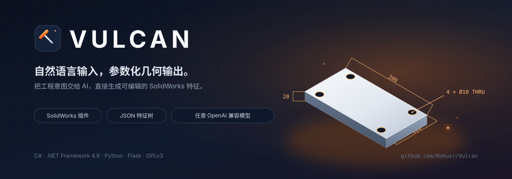
</p>

## 名称由来

SolidWorks 精确、强大，也以点击繁多著称。一块带四个孔的安装板，往往要经历十几次操作：选择基准面、绘制矩形、标注尺寸、退出草图、拉伸、选择表面、绘制圆、做阵列、完全贯穿切除。

Vulcan 把这一串操作压缩成一句话。名字来自罗马神话中的火神与锻冶之神伏尔甘（Vulcan）——熔炉是原材料与刻意意图相遇的地方。在这里，原材料是语言，意图是一棵参数化特征树。

仓库保留了两代实现：

- **`beta/`**——最初的概念验证。大模型生成 Python 代码，客户端用 `exec()` 执行。
- **`release/`**——当前维护的架构。大模型返回类型化的 JSON 特征树，由 C# 插件确定性执行。

本 README 以 `release/` 为主；`beta/` 作为参考与设计演进的记录保留。

## 它能做什么

<p align="center">
  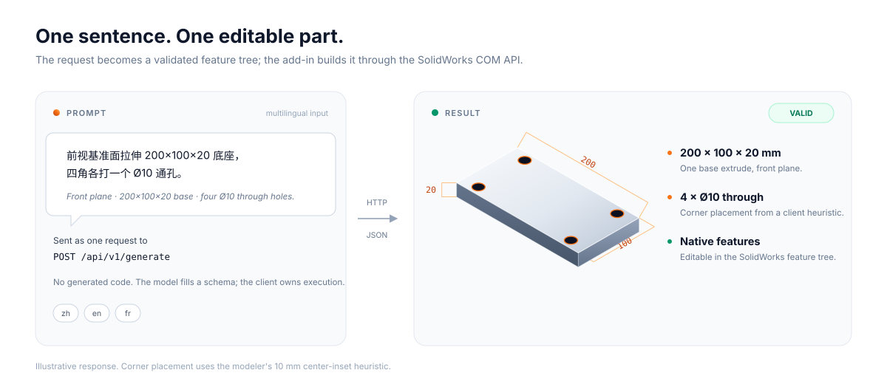
</p>

<p align="center">
  <sub>示意图。同一份契约可以承载一个基础拉伸和一组有序切除。</sub>
</p>

<p align="center">
  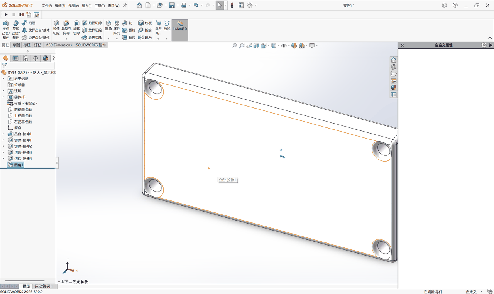
</p>

<p align="center">
  <sub>SolidWorks 2025 真实输出：200 × 100 × 20 毫米、四角 10 毫米通孔、边缘带圆角的安装板。由本地测试程序生成并截图。</sub>
</p>

<p align="center">
  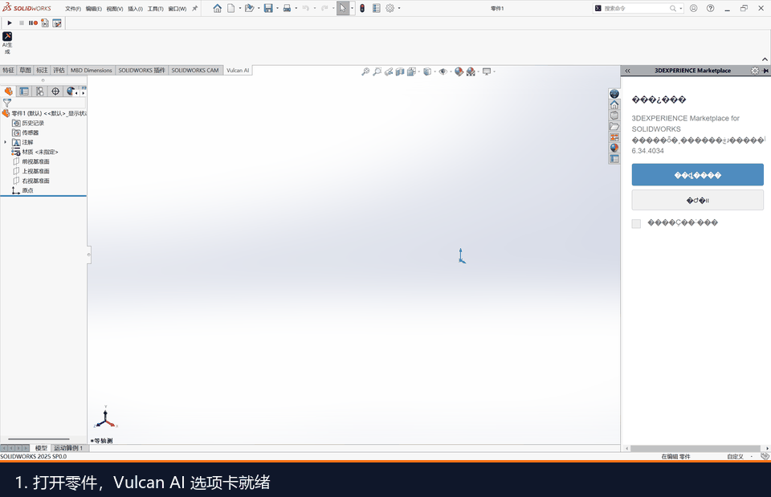
</p>

<p align="center">
  <sub>1.2.1 实际工作流：打开面板 → 配置服务端 → 描述零件 → 检查或编辑 JSON → 由插件写入原生特征。截取自已安装的插件。</sub>
</p>


1. **描述零件。** 在插件面板中输入需求。多语言模型可以理解中文、英文和法文；系统提示词本身以中文编写。
2. **模型填充模式。** 服务端拼接版本化的 SolidWorks 领域提示词，调用任意 OpenAI 兼容端点。模型返回 JSON，而不是代码。
3. **插件完成建模。** C# 客户端反序列化特征树，绘制草图并调用 SolidWorks 原生特征 API。结果是原生、可编辑的特征树。

## 能力一览

| 能力 | 说明 |
|---|---|
| 自然语言建模 | 一句需求变成有序特征树：先基础特征，后续特征依次叠加。 |
| 原生输出 | 生成可编辑的 SolidWorks 特征，而不是网格、宏或脚本。 |
| 结构化契约 | JSON 信封承载 `extrude`、`cut`、`revolve`、`fillet`、`chamfer`；JSON 用毫米，COM 边界转换为米。 |
| 草图形状库 | 圆形、矩形、正多边形、椭圆、直槽口。 |
| 特征库 | 拉伸、切除、旋转、圆角、倒角，以及孔别名。 |
| 孔位控制 | 显式 `center_x`、`center_y`、`through_all`，以及会读取原始中文或英文提示词的四角孔启发式。 |
| 提供商自由 | OpenAI、DeepSeek、通义千问、七牛云、vLLM、Ollama 或任意兼容端点。 |
| 服务端可移植 | 本地、Docker 或隧道后运行；只有客户端需要 Windows。 |
| 可调试管线 | release 版本没有 `exec()`；每个阶段都有日志和类型。 |
| API 优先执行 | 优先调用原生特征 API；拉伸和切除失败时，使用键盘驱动的原生面板兜底。 |
| 自带密钥 | 在插件设置对话框中填写提供商密钥、Base URL 和模型。密钥用 Windows DPAPI 在本机加密，仅在一次请求期间发送到你自己的 Vulcan 服务端。 |
| 可编辑预览 | 每份响应都会打开可编辑的 JSON 预览，确认之前不会写入 SolidWorks。 |
| 静默安装与卸载 | 安装包自动提权，静默调用 `RegAsm` 注册 x64 插件，卸载时干净移除注册。 |

## 系统架构

<p align="center">
  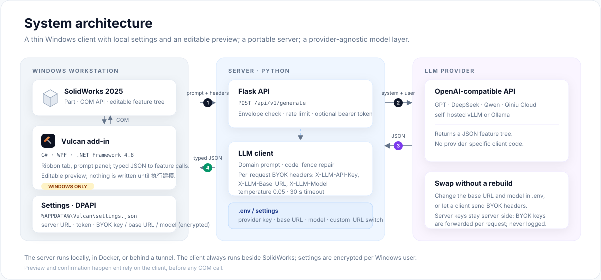
</p>

| 层次 | 技术栈 | 职责 |
|---|---|---|
| 客户端 | C# / WPF / .NET Framework 4.8 | `Vulcan AI` 功能区标签页、提示面板、DPAPI 设置、可编辑 JSON 预览、COM 执行 |
| 传输 | HTTP REST / JSON | 单一端点：`POST /api/v1/generate` |
| 服务端 | Python 3.10+ / Flask 3 | 提示词组装、上游大模型调用、信封与参数校验、错误映射 |
| 模型 | OpenAI 兼容 API | JSON 特征树生成 |
| 部署 | Docker、反向代理或裸机 | 服务端任意部署；客户端与 SolidWorks 同机 |

插件会在零件、装配和工程图中注册 `Vulcan AI` 功能区标签页，同时提供工具栏和菜单命令。按钮打开一个模态 WPF 面板，而不是独立的 CAD 应用。

<p align="center">
  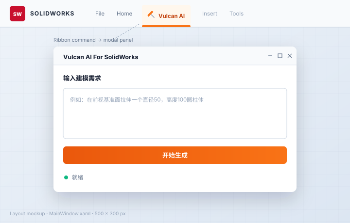
</p>

<p align="center">
  <sub>520 × 320 提示面板的布局示意。实际交付界面为中文；面板接受自然语言需求。</sub>
</p>

## 请求生命周期

<p align="center">
  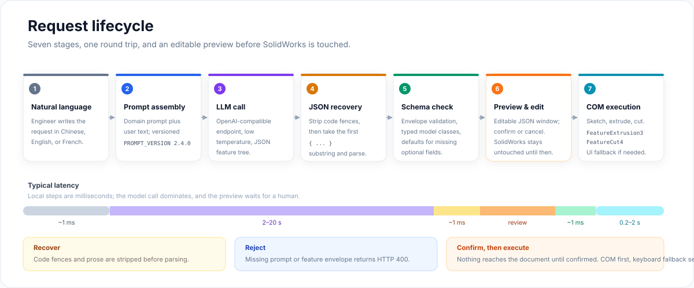
</p>

1. **请求。** 插件把 `{ "prompt": "..." }` 发送到 Flask 服务端。
2. **提示词组装。** 服务端在用户文本前拼接版本化的 SolidWorks 领域提示词。
3. **模型调用。** 任意 OpenAI 兼容端点返回 JSON 特征树。默认参数为 `temperature 0.05`、`top_p 0.95`、`max_tokens 2048`，超时 30 秒。
4. **恢复。** 服务端去除 Markdown 代码围栏，再截取第一个 `{` 到最后一个 `}` 后解析。
5. **校验。** Flask 检查响应信封并校验特征参数；C# 客户端把信封反序列化为类型化模型类，再从参数字典读取参数并应用建模器默认值。
6. **预览与编辑。** 插件打开可编辑的 JSON 窗口；确认之前不会写入文档。
7. **执行。** `SwModeler` 绘制草图、选中草图，并调用原生特征 API，包括 `FeatureExtrusion3`、`FeatureCut4`、`FeatureRevolve`、`FeatureFillet3` 和 `InsertFeatureChamfer`。拉伸或切除失败时，键盘驱动的兜底方案会打开 SolidWorks 原生特征面板。

模型调用占据绝大部分延迟；其余步骤都在本地，通常在毫秒级。

## JSON 契约

<p align="center">
  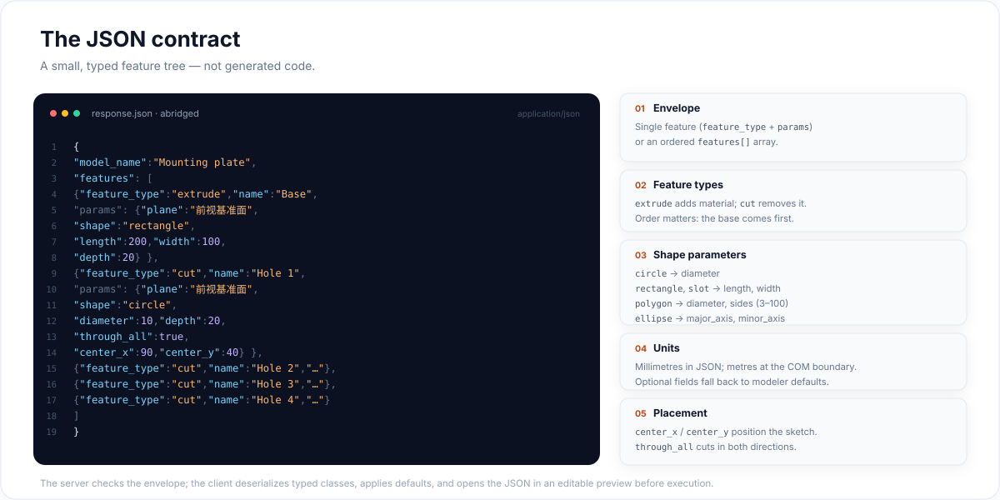
</p>

### 信封

响应可以是单个特征：

```json
{
  "feature_type": "extrude",
  "name": "Cylinder",
  "params": {
    "plane": "前视基准面",
    "shape": "circle",
    "diameter": 50,
    "depth": 100
  }
}
```

也可以是有序的多特征模型：

```json
{
  "model_name": "Mounting plate",
  "features": [
    {
      "feature_type": "extrude",
      "name": "Base",
      "params": {
        "plane": "前视基准面",
        "shape": "rectangle",
        "length": 200,
        "width": 100,
        "depth": 20
      }
    },
    {
      "feature_type": "cut",
      "name": "Hole 1",
      "params": {
        "plane": "前视基准面",
        "shape": "circle",
        "diameter": 10,
        "depth": 20,
        "through_all": true,
        "center_x": 90,
        "center_y": 40
      }
    }
  ]
}
```

这里只展示四个孔中的一个；完整响应会重复 `cut` 特征，填入其余三个角的坐标。

### 特征类型

| 类型 | 用途 | 关键参数 |
|---|---|---|
| `extrude` | 创建基体或添加材料。 | `plane`、`shape`、`depth` |
| `cut` / `hole` | 从当前实体移除材料。 | `plane`、`shape`、`depth`；完全贯穿时可用 `through_all` |
| `revolve` | 让偏离旋转轴的轮廓绕轴旋转。 | `plane`、`shape`、轮廓尺寸，以及偏离轴的 `center_x` 或 `center_y` |
| `fillet` | 对当前实体的所有边倒圆。 | `radius` |
| `chamfer` | 对当前实体的所有边等距倒角。 | `distance` |

### 特征模式

| 字段 | 类型 | 必填 | 说明 |
|---|---|---|---|
| `feature_type` | string | 是 | `extrude`、`cut`、`revolve`、`fillet` 或 `chamfer` |
| `name` | string | 否 | 用于日志的可读名称 |
| `params.plane` | string | 草图特征必填 | 请求的基准面；支持前视、上视、右视 |
| `params.shape` | string | 草图特征必填 | `circle`、`rectangle`、`polygon`、`ellipse` 或 `slot` |
| `params.depth` | number | 拉伸必填；切除在非贯穿时必填 | 盲拉伸/盲切除深度，毫米；`through_all` 为 true 时忽略 |
| `params.through_all` | boolean | 否 | 仅切除；默认 `false`；为 true 时双向切除 |
| `params.center_x` | number | 多孔切除、旋转轮廓 | 草图中心在第一个草图轴上的坐标，毫米 |
| `params.center_y` | number | 多孔切除、旋转轮廓 | 草图中心在第二个草图轴上的坐标，毫米 |
| `params.radius` | number | 仅圆角 | 圆角半径，毫米；作用于所有边 |
| `params.distance` | number | 仅倒角 | 等距倒角距离，毫米；作用于所有边 |
| `params.angle` | number | 否 | 旋转角度，度；默认 360 |
| `params.axis` | string | 否 | 旋转轴，`x` 或 `y`；默认 `y` |
| `params.draft_angle` | number | 否 | 拉伸/切除的拔模角度，度 |

### 草图形状参数

| 形状 | 必填字段 | 说明 |
|---|---|---|
| `circle` | `diameter` | 毫米 |
| `rectangle` | `length`、`width` | 以 `center_x`、`center_y` 为中心 |
| `polygon` | `diameter`、`sides` | `sides` 限制在 3–100 |
| `ellipse` | `major_axis`、`minor_axis` | 毫米 |
| `slot` | `length`、`width` | 直槽口；宽度即两端圆弧直径 |

补充特征参数：

- **`revolve`：** 轮廓必须偏离旋转轴。把 `center_x` 或 `center_y` 设为非零值，可选 `axis` 为 `x` 或 `y`，`angle` 为 1 到 360 度。
- **`fillet`：** 必填 `radius`；对当前实体的所有边应用等半径圆角。
- **`chamfer`：** 必填 `distance`；对当前实体的所有边应用等距倒角。
- **`draft_angle`：** `extrude` 和 `cut` 可选，单位为度，范围 -89 到 89。

### 坐标与单位

- **前视基准面：** 草图轴为 X、Y；`center_x` 对应 X，`center_y` 对应 Y。
- **上视基准面：** 草图轴为 X、Z；`center_y` 对应 Z，且必须落在基体厚度内。
- **右视基准面：** 草图轴为 Y、Z；`center_x` 对应 Y，`center_y` 对应 Z。
- **多特征模型：** 先读取基体的 `length`、`width`、`depth`，再计算后续坐标。不要把多个相同特征堆在 `(0, 0)`。
- **单位：** JSON 中所有尺寸均为毫米；建模器在 COM 边界转换为米。

### 实现说明

当前 release 建模器会把草图绘制到请求的基准面，并能在中文、英文、法文界面中解析前视、上视、右视。对于四角孔，当用户用中文或英文明确要求“四角”“4个”“四个”“4通孔”或“four corners”时，客户端还会在前视 X/Y 坐标中按 `±(length / 2 − 10)` 与 `±(width / 2 − 10)` 自动分配孔位。

## 设计取舍

<p align="center">
  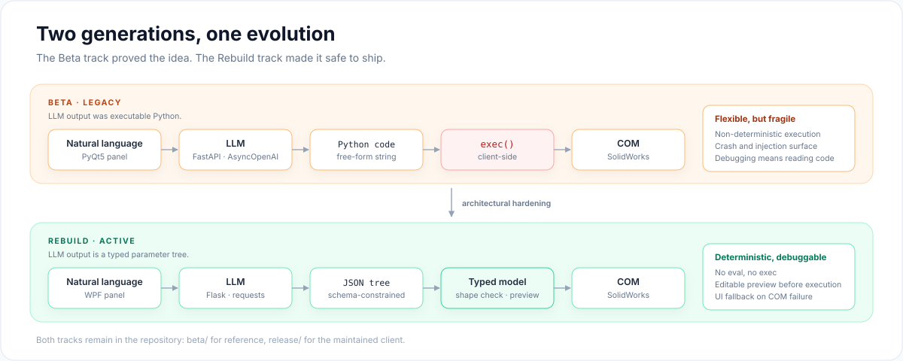
</p>

### 用 JSON 参数，而不是生成代码

Beta 版本让大模型直接输出 Python 代码，由客户端用 `exec()` 执行。这种方式在演示中很灵活，也很惊艳，但工程上很脆弱：幻觉生成的 API 调用可能让 SolidWorks 崩溃，错误恢复几乎不可能，调试意味着阅读一段没人写过的代码。

Rebuild 版本把大模型当作**由模式驱动的参数填充器**。模型只负责填充一个小而类型化的模板，C# 客户端掌握执行权。JSON 合法且参数通过校验，特征调用就是良构的；否则服务端会在触及 SolidWorks 之前拒绝响应。release 客户端中没有 `exec()`，也没有代码注入面。

### 薄客户端，可移植服务端

1. **默认把密钥留在服务端。** 把大模型 API 密钥嵌入客户端宏不可接受。当用户选择自带密钥时，插件会用 Windows DPAPI 在本机加密保存，并只在单次请求期间转发给用户自己的 Vulcan 服务端。
2. **提示词可以快速迭代。** 更新服务端提示词只需几秒；发布新插件则需要重新构建和安装。
3. **服务端可以无头运行。** 这为批处理、CI 检查和未来的 Web 前端保留了空间。

### 领域提示词，而不是通用提示词

通用模型在 CAD 任务上表现不佳，不是因为不够聪明，而是因为缺少上下文。它们不知道前视基准面和上视基准面的区别，也不知道切除特征的 Z 坐标必须落在基体厚度内。

Vulcan 通过 [`system_prompt.py`](release/server/prompts/system_prompt.py) 提供这些上下文：基准面与坐标轴的映射、特征模式、形状专属字段、输出纪律，以及多特征模型的防重叠规则。

### API 优先，UI 兜底

SolidWorks 互操作接口对版本很敏感。建模器直接调用原生特征 API，包括 `FeatureExtrusion3`、`FeatureCut4`、`FeatureRevolve`、`FeatureFillet3` 和 `InsertFeatureChamfer`。如果拉伸或切除调用失败，兜底方案会激活 `RunCommand`，用模拟按键填写原生特征面板。

兜底方案是务实的，不是优雅的。生成模型时请保持 SolidWorks 在前台；如果兜底频繁触发，应视为需要更新互操作参数的信号。

## 提示词工程

系统提示词位于 [`release/server/prompts/system_prompt.py`](release/server/prompts/system_prompt.py)，版本为 `PROMPT_VERSION = "2.2.0"`，约 198 行。它编码了五件事：

1. **输出纪律。** 只输出 JSON——没有 Markdown、没有解释、没有代码围栏。
2. **坐标规则。** 逐基准面的轴映射，并给出 200 × 100 × 20 基体与四个孔的完整示例。
3. **特征模式。** `extrude`、`cut`、`revolve`、`fillet`、`chamfer` 的必填/可选字段，以及形状专属参数。
4. **防重叠约束。** 多个相同特征必须使用不同坐标，绝不能堆在原点。
5. **基准面词汇。** 模型必须输出 `前视基准面`、`上视基准面`、`右视基准面` 等中文名称。

提示词与业务逻辑刻意分离，因此可以独立迭代，不必改动服务端。模型调用使用较低的温度，因为这项任务奖励一致性，而不是创造力。

## 快速开始

### 环境要求

| 组件 | 要求 |
|---|---|
| 服务端 | Python 3.10–3.11，以及一个 OpenAI 兼容 API 密钥 |
| 客户端 | Windows 10/11、SolidWorks 2025（已测试）、.NET Framework 4.8 |
| 构建工具 | Visual Studio 2022，含 .NET 桌面开发工作负载 |
| 网络 | 客户端能访问服务端；服务端能访问大模型提供商 |

### 1. 克隆仓库

```bash
git clone https://github.com/Robusr/Vulcan.git
cd Vulcan
```

### 2. 启动服务端

```bash
cd release/server

python -m venv venv
source venv/bin/activate   # Windows: venv\Scripts\activate

pip install -r requirements.txt
cp .env.example .env
# 编辑 .env：填入提供商密钥、Base URL 和模型名称

python app.py
# → http://127.0.0.1:5000
```

服务端默认绑定 `127.0.0.1:5000`，仅在 `FLASK_ENV=development` 时开启调试模式。只有放在可信反向代理之后时才设置 `HOST=0.0.0.0`，并在暴露服务前设置 `VULCAN_API_TOKEN`。

### 3. 或使用 Docker

```bash
cd release/server
docker build -t vulcan-server .
docker run --rm -p 5000:5000 --env-file .env vulcan-server
```

### 4. 验证 API

```bash
curl -s http://127.0.0.1:5000/api/v1/generate \
  -H "Content-Type: application/json" \
  -d '{"prompt":"前视基准面拉伸200x100x20底座，四角各打一个直径10mm通孔"}'
```

响应就是特征树本身，没有额外包装。如果设置了 `VULCAN_API_TOKEN`，请加上 `-H "Authorization: Bearer $VULCAN_API_TOKEN"`。第一次请求可能需要几秒钟等待模型返回。

### 5. 安装或构建客户端

**方案 A——预编译安装包。** 预编译安装包可以通过 GitHub Releases 分发，也可以在本地构建。先编译 `Release / x64`，再运行 `build_installer.ps1`；它会把负载暂存到 `dist/`，并生成 `Vulcan Setup/Output/Vulcan-Setup-1.2.1.exe`。安装包会自动请求管理员权限，静默调用 `RegAsm` 注册 x64 插件，不会留下挂起的控制台窗口。安装完成后启动 SolidWorks，在插件面板右上角点击**设置**，填写服务端地址、可选的服务端 Token，以及（如果你想使用自己的密钥）LLM API Key、Base URL 和模型名称。设置保存在 `%APPDATA%\Vulcan\settings.json`，其中密钥由 Windows DPAPI 加密。

**方案 B——从源码构建。**

1. 在 Visual Studio 2022 中打开 `release/client/Vulcan.SolidWorksClient/Vulcan.SolidWorksClient.sln`。
2. 还原 NuGet 包（客户端使用 `Newtonsoft.Json`）。
3. 项目使用 `ReferenceDLL/` 中的 SolidWorks 互操作程序集；如果你的 SolidWorks 版本不同，请替换这些文件。
4. 构建并注册后，打开**设置**对话框填写服务端地址，例如 `https://vulcan.example.com`；如果服务端启用了鉴权，再填写 `VULCAN_API_TOKEN`。等价的环境变量（`VULCAN_SERVER_URL`、`VULCAN_API_TOKEN`）仍然可用，并在设置对话框留空时作为兜底。
5. 构建 `Release / x64`。SolidWorks 是 64 位程序，不要发布 x86 构建。
6. 运行 `build_installer.ps1` 暂存负载，然后以管理员身份执行 `dist\install.bat`，或直接运行 `RegAsm.exe Vulcan.SolidWorksClient.dll /codebase`。
7. 重启 SolidWorks，打开一个零件文档。`Vulcan AI` 功能区标签页应当出现。

### 6. 生成第一个模型

打开 Vulcan 面板，尝试以下任一提示词：

```text
前视基准面拉伸200x100x20底座，四角各打一个直径10mm通孔
```

```text
Create a 200 x 100 x 20 mm base on the front plane, with a 10 mm through hole at each corner.
```

```text
Créez une base de 200 x 100 x 20 mm sur le plan de face, avec un trou traversant de 10 mm à chaque coin.
```

点击**开始生成**。插件获取特征树后会先打开可编辑的 JSON 预览：确认参数、修正模型理解有偏差的地方，再点击**执行建模**。此时才会写入 SolidWorks、自动缩放到合适视图，并留下可编辑的特征树；取消预览不会改动当前文档。

## 操作演练

这一节逐项说明从安装包到特征树会接触到的每个实体。

### 1. 安装

1. 运行 `Vulcan-Setup-1.2.1.exe`，在 UAC 提示中允许管理员权限，阅读 GPLv3 许可页，保留默认安装目录 `{autopf}\Vulcan`。
2. 安装包复制插件、依赖、图标资源以及 `install.bat` / `uninstall.bat`，随后以 `install.bat /quiet` 调用 `RegAsm` 注册 x64 插件。
3. 也可以解压 `Vulcan-1.2.1-portable.zip`，以管理员身份运行 `install.bat`。
4. 重启 SolidWorks。

### 2. 打开面板

| 实体 | 位置 | 作用 |
|---|---|---|
| `Vulcan AI` 功能区标签 | CommandManager 最后一个标签 | 承载“打开AI生成窗口”命令 |
| `AI生成` 工具栏按钮 | 左侧工具栏 | 打开同一个模态面板 |
| `Vulcan AI For SolidWorks` 窗口 | SolidWorks 中央 | 520 × 320 提示面板 |

### 3. 配置服务端

点击面板右上角的**设置**，对话框包含五个输入项和四个按钮。

| 输入项 | 含义 |
|---|---|
| 服务端地址 | Vulcan 服务端地址，默认 `http://127.0.0.1:5000` |
| 服务端 Token | 服务端启用鉴权时对应 `VULCAN_API_TOKEN` |
| LLM API Key | 你自己的提供商密钥（BYOK）；留空则使用服务端密钥 |
| LLM Base URL | 提供商的 OpenAI 兼容 Base URL |
| 模型名称 | 例如 `gpt-4o-mini` |

| 按钮 | 行为 |
|---|---|
| 测试连接 | 调用 `GET /health`，在对话框内显示响应 |
| 打开日志目录 | 打开桌面 `Vulcan_Logs` |
| 取消 | 关闭且不保存 |
| 保存 | 写入 `%APPDATA%\Vulcan\settings.json`；Token 与 BYOK 密钥由 DPAPI 加密 |

### 4. 描述零件

在白色输入卡片中输入需求，例如 `在前视基准面拉伸一个直径40，高度60的圆柱体`；聚焦时占位提示自动消失。点击**开始生成**会发送 `POST /api/v1/generate`，空闲时状态点为绿色。

### 5. 检查并编辑 JSON

**检查并编辑建模参数**窗口展示原始需求、可编辑 JSON 编辑器和两个按钮。

| 实体 | 行为 |
|---|---|
| JSON 编辑器 | 可直接修改；必须保留 `feature_type`（或 `features[]`）与 `params` 对象 |
| 执行建模 | 校验修改后的 JSON，关闭预览并调用建模器 |
| 取消 | 关闭预览，文档保持不变 |

### 6. 查看结果

建模器创建原生特征（示例为 `凸台-拉伸1` 及其草图），并弹出“模型生成完成!”提示。客户端日志写入 `Vulcan_Logs\log_YYYYMMDD.txt`，服务端日志写入 `vulcan_server.log`。

## 1.2.1 更新要点

- 功能区、工具栏与命令按钮使用品牌多尺寸图标。
- 重绘提示面板、设置对话框与可编辑 JSON 预览。
- 安装包加入 GPLv3 许可页、现代向导、静默注册与卸载清理。
- 自带密钥（BYOK）设置使用 Windows DPAPI 加密保存。
- README 内嵌带说明条的安装、工作流与卸载 GIF。

## 安装、升级与卸载

### 环境要求

| 组件 | 要求 |
|---|---|
| 操作系统 | Windows 10/11，x64 |
| CAD | SolidWorks 2025（已测试）；旧版本可能需要 UI 兜底 |
| 运行时 | .NET Framework 4.8 |
| 服务端 | 正在运行的 Vulcan 服务端，本地或远程 |

### 安装

<p align="center">
  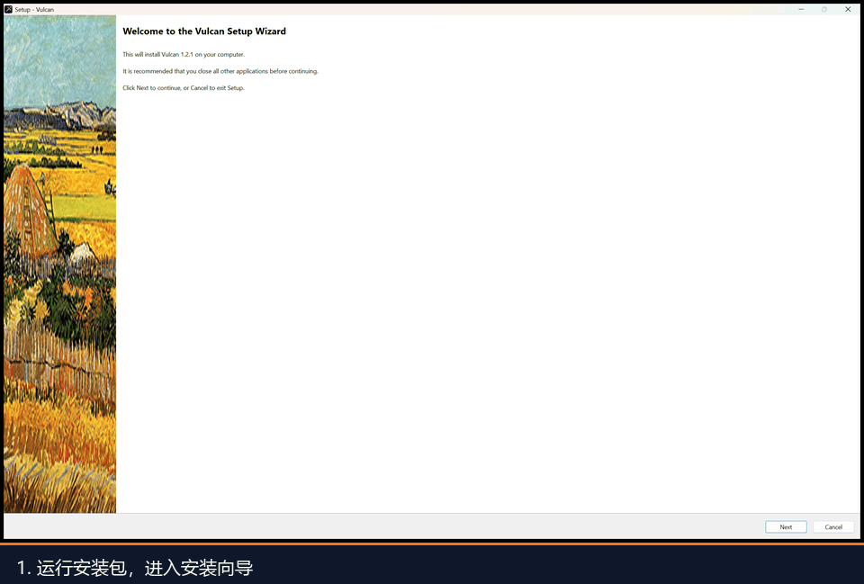
</p>

1. 运行 `Vulcan-Setup-1.2.1.exe`，在 UAC 提示中允许管理员权限。
2. 接受 GPLv3 许可，保留默认目录 `{autopf}\Vulcan` 或选择其他位置。
3. 安装包复制插件、依赖与图标，并以 `install.bat /quiet` 调用 `RegAsm` 注册 x64 插件。
4. 重启 SolidWorks，`Vulcan AI` 标签页与 `AI生成` 工具栏按钮即可使用。

静默安装：

```bat
Vulcan-Setup-1.2.1.exe /VERYSILENT /SUPPRESSMSGBOXES /NORESTART
```

便携方式：解压 `Vulcan-1.2.1-portable.zip`，以管理员身份运行 `install.bat`。

### 升级

在已有安装上直接运行新版安装包。安装程序沿用原目录并重新注册插件，不会改动 `%APPDATA%\Vulcan\settings.json`，服务端地址、Token 与 BYOK 配置都会保留。

### 卸载

<p align="center">
  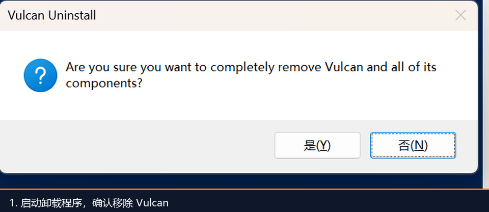
</p>

1. 打开 **设置 → 应用 → 已安装的应用**，找到 **Vulcan AI For SolidWorks** 并选择**卸载**；也可以运行 `C:\Program Files\Vulcan\unins000.exe`。
2. 确认移除。卸载程序执行 `uninstall.bat /quiet`，注销插件、删除安装目录，并清理 SolidWorks 插件注册表项。
3. 重启 SolidWorks。`%APPDATA%\Vulcan` 中的设置与桌面 `Vulcan_Logs` 中的日志会被保留；如需彻底清理请手动删除。

静默卸载：

```bat
"C:\Program Files\Vulcan\unins000.exe" /VERYSILENT /SUPPRESSMSGBOXES /NORESTART
```

## 测试

服务端测试使用 Flask 测试客户端和模拟的大模型客户端。客户端构建与安装包由 GitHub Actions 工作流覆盖。

```bash
cd release/server
pip install -r requirements.txt -r requirements-dev.txt
pytest
pip-audit -r requirements.txt
```

## 配置说明

### 服务端环境变量

```env
QINIU_API_KEY="sk-xxxxxxxxxxxxxxxx"
QINIU_BASE_URL="https://api.openai.com/v1"
QINIU_MODEL="gpt-4o-mini"

HOST="127.0.0.1"
PORT="5000"
FLASK_ENV="production"
VULCAN_API_TOKEN=""
VULCAN_RATE_LIMIT_PER_MINUTE="60"
MAX_PROMPT_LENGTH="4000"
LLM_TIMEOUT="30"
LOG_LEVEL="INFO"
LOG_FILE="vulcan_server.log"
```

`QINIU_*` 是历史命名：第一次部署使用七牛云。客户端本身兼容 OpenAI 接口，因此这些名称只对 `config.py` 有意义。

| 变量 | 默认值 | 用途 |
|---|---|---|
| `QINIU_API_KEY` | 无 | 提供商 API 密钥 |
| `QINIU_BASE_URL` | 无 | OpenAI 兼容 Base URL |
| `QINIU_MODEL` | `gpt-oss-120b` | 模型名称 |
| `HOST` | `127.0.0.1` | 绑定地址；仅在可信反向代理之后使用 `0.0.0.0` |
| `PORT` | `5000` | 服务端口 |
| `FLASK_ENV` | `production` | 设为 `development` 才开启 Flask 调试模式 |
| `VULCAN_API_TOKEN` | 无 | 可选的客户端 Bearer Token |
| `VULCAN_RATE_LIMIT_PER_MINUTE` | `60` | 生成接口的每 IP 每分钟限额；`0` 表示关闭 |
| `MAX_PROMPT_LENGTH` | `4000` | 提示词最大字符数 |
| `LLM_TIMEOUT` | `30` | 上游请求超时秒数 |
| `LOG_LEVEL` | `INFO` | 日志级别；INFO 只记录提示词长度 |
| `LOG_FILE` | `vulcan_server.log` | 轮转日志文件 |

### 提供商示例

| 提供商 | `QINIU_BASE_URL` | 模型示例 |
|---|---|---|
| OpenAI | `https://api.openai.com/v1` | `gpt-4o-mini` |
| DeepSeek | `https://api.deepseek.com/v1` | `deepseek-chat` |
| 通义千问（DashScope 兼容模式） | `https://dashscope.aliyuncs.com/compatible-mode/v1` | `qwen-plus` |
| Ollama | `http://localhost:11434/v1` | 本地部署的模型 |
| vLLM | `http://localhost:8000/v1` | 你部署的模型 |

建议选择指令遵循能力强、JSON 输出稳定的模型。较弱的模型通常会出现这些问题：Markdown 包裹、JSON 前后夹杂解释，或坐标重叠。

### 客户端设置

插件在自己的对话框中完成配置：点击 Vulcan 面板右上角的**设置**。

| 字段 | 用途 |
|---|---|
| 服务端地址 | Vulcan 服务端，例如 `https://vulcan.example.com` |
| 服务端 Token | 对应 `VULCAN_API_TOKEN`，服务端启用鉴权时填写 |
| LLM API Key | 你自己的提供商密钥；留空则使用服务端配置 |
| LLM Base URL | 提供商的 OpenAI 兼容 Base URL |
| 模型名称 | 例如 `gpt-4o-mini` |

对话框还提供**测试连接**（健康检查）、**打开日志目录**和**保存**。设置写入 `%APPDATA%\Vulcan\settings.json`，其中 `ServerToken` 和 `LlmApiKey` 使用 Windows DPAPI 按当前用户加密，因此文件不能跨机器或跨账户复制，也不能提交到仓库。

服务端地址的优先级为：构造函数显式参数 → 设置对话框 → `VULCAN_SERVER_URL` 环境变量 → `http://127.0.0.1:5000`；Token 遵循同样的顺序。LLM 覆盖项以 `X-LLM-API-Key`、`X-LLM-Base-URL`、`X-LLM-Model` 请求头发送给服务端，留空的字段不会发送，服务端会回退到自己的 `QINIU_*` 配置。

环境变量仍然适用于脚本化或共享部署：

```bat
setx VULCAN_SERVER_URL "https://vulcan.example.com"
setx VULCAN_API_TOKEN "your-shared-token"
```

非本机地址必须使用 HTTPS，除非在可信局域网内设置 `VULCAN_ALLOW_INSECURE=true`。

### 参数调节

- [`llm_client.py`](release/server/services/llm_client.py) 中的 `temperature 0.05`、`top_p 0.95`、`max_tokens 2048` 控制模型调用。
- [`config.py`](release/server/config.py) 中的 `LLM_TIMEOUT = 30` 控制服务端请求超时。
- `ApiClient` 使用 30 秒客户端超时。如果提高其中一个，请同步提高另一个。

## API 参考

### `POST /api/v1/generate`

请求：

```json
{
  "prompt": "前视基准面拉伸200x100x20底座，四角各打一个直径10mm通孔"
}
```

成功——`200 OK`，返回特征树：

```json
{
  "model_name": "Mounting plate",
  "features": [
    {
      "feature_type": "extrude",
      "name": "Base",
      "params": {
        "plane": "前视基准面",
        "shape": "rectangle",
        "length": 200,
        "width": 100,
        "depth": 20
      }
    }
  ]
}
```

错误使用统一信封：

```json
{
  "message": "缺少必要字段: prompt",
  "status": "error"
}
```

| 状态码 | 触发条件 |
|---|---|
| `400` | 缺少、非字符串、过长或为空的 `prompt`，没有有效的特征信封，或特征参数无效 |
| `401` | 设置了 `VULCAN_API_TOKEN`，但 Bearer Token 缺失或错误 |
| `429` | 超过每 IP 限流 |
| `503` | 大模型提供商不可达，或请求超时 |
| `500` | 大模型响应无法解析，或其他服务端未知错误 |

**自带密钥请求头（可选）。** 插件可以针对单次请求覆盖服务端的提供商：

| 请求头 | 用途 |
|---|---|
| `X-LLM-API-Key` | 提供商密钥，仅用于本次请求 |
| `X-LLM-Base-URL` | OpenAI 兼容 Base URL；`VULCAN_ALLOW_CUSTOM_LLM_BASE_URL=false` 时忽略 |
| `X-LLM-Model` | 模型名称 |

未提供的请求头回退到 `QINIU_*`。取值有长度上限，Base URL 必须以 `http` 或 `https` 开头，密钥和提示词都不会写入服务端日志。

**安全提示。** 服务端支持可选的 Bearer Token 和每 IP 限流，但不终止 TLS，也没有用户账户。请保持 `HOST=127.0.0.1`，或放在 TLS 反向代理之后，设置 `VULCAN_API_TOKEN`，并且不要在生产环境开启 Flask 调试模式。

## 项目结构

```text
Vulcan/
├── README.md                     # 英文（默认）
├── README.zh-CN.md               # 简体中文
├── README.fr.md                  # 法文
├── SECURITY.md                   # 安全策略与密钥轮换
├── scripts/                      # 维护脚本
├── docs/
│   └── assets/                   # 三份 README 共用的矢量配图
│
├── beta/                         # 旧版代码生成路线
│   ├── client-csharp-beta/       #   早期命令组/功能区原型
│   ├── client-python-beta/       #   使用 exec() 的 PyQt5 客户端
│   └── server-python-beta/       #   FastAPI + AsyncOpenAI 服务端
│
└── release/                      # 当前 JSON 契约路线
    ├── client/
    │   └── Vulcan.SolidWorksClient/
    │       ├── Core/             #   SwAddIn——COM 注册与生命周期
    │       ├── Models/           #   ModelData——请求/响应类型
    │       ├── Services/         #   ApiClient、SwModeler、SettingsStore、Logger
    │       ├── UI/               #   MainWindow、SettingsWindow、PreviewWindow（WPF）
    │       ├── ReferenceDLL/     #   SolidWorks 互操作程序集
    │       ├── Vulcan Setup/     #   Inno Setup 安装包
    │       └── packaging/        #   install/uninstall 脚本与 build_installer.ps1
    └── server/
        ├── app.py                #   Flask 入口
        ├── config.py             #   环境配置
        ├── .env.example          #   提供商、鉴权与服务端配置模板
        ├── Dockerfile            #   python:3.11-slim + gunicorn 镜像
        ├── prompts/              #   版本化系统提示词
        ├── services/             #   大模型客户端与特征校验器
        ├── tests/                #   pytest 测试
        └── utils/                #   日志、限流与自定义异常
```

**仓库说明。** release 客户端实际编译 `Core/SwAddIn.cs`。`beta/` 仅作参考，不再维护。构建产物、日志、`.env` 和安装包负载都不进入 Git。

## 兼容性与当前范围

| 领域 | 状态 |
|---|---|
| SolidWorks | 已在 SolidWorks 2025 上构建并测试（`FeatureExtrusion3`、`FeatureCut4`、`FeatureRevolve`、`FeatureFillet3`、`InsertFeatureChamfer`）。旧版本可能需要调整参数或使用 UI 兜底，不在已测试矩阵内。 |
| 客户端平台 | 仅 Windows，x64，.NET Framework 4.8。 |
| 服务端平台 | Python 3.10–3.11；本地、Docker 或无头运行。 |
| 特征类型 | 已实现 `extrude`、`cut`、`revolve`、`fillet`、`chamfer`。未实现扫描和放样。 |
| 基准面 | 建模器支持前视、上视、右视基准面，并能解析中文、英文、法文名称。 |
| 校验 | 服务端检查响应信封并校验特征参数；信封反序列化和字段默认值位于 C# 客户端。 |
| 鉴权 | 支持可选的 Bearer Token（`VULCAN_API_TOKEN`）和每 IP 限流。TLS 与用户账户仍应由反向代理负责。 |
| 大模型质量 | 延迟和正确性取决于提供商；建议使用指令遵循能力强的模型。 |

## 故障排除

| 现象 | 可能原因 | 处理方式 |
|---|---|---|
| `Vulcan AI` 标签页不出现 | 插件未注册，或构建为 x86 | 构建 x64 Release 配置，以管理员身份运行 `install.bat` 或 `RegAsm`，重启 SolidWorks |
| “目标计算机积极拒绝连接” | 服务端未运行，或 `VULCAN_SERVER_URL` 错误 | 启动 `python app.py`；检查主机和端口；开放防火墙 |
| 没有活动文档 | SolidWorks 未打开零件 | 新建或打开零件文档后重试 |
| 草图出现但拉伸失败 | 互操作版本不匹配或 SolidWorks 状态异常 | 查看桌面 `Vulcan_Logs`；更新 `FeatureExtrusion3` 参数；生成时保持 SolidWorks 前台 |
| 圆角或倒角失败 | 半径/距离过大，或实体没有可选的边 | 减小数值，检查基体，并查看 `Vulcan_Logs` |
| 旋转失败 | 轮廓落在或穿过旋转轴 | 把 `center_x` 或 `center_y` 移离旋转轴 |
| 安装后服务端测试失败 | 缺少开发依赖 | 运行 `pip install -r requirements.txt -r requirements-dev.txt` |
| 大模型返回空或畸形响应 | 模型未遵守 JSON 契约 | 换用更强的模型，降低 `temperature`，检查 `vulcan_server.log` |
| 请求超时 | 模型耗时超过 30 秒 | 同时提高 `LLM_TIMEOUT` 和 `ApiClient` 超时 |
| 中文或法文需求理解偏差 | 模型缺乏多语言工程词汇 | 使用多语言模型；系统提示词为中文 |
| 构建时报 SolidWorks 引用错误 | `ReferenceDLL/` 与当前 SolidWorks 版本不匹配 | 用版本匹配的互操作程序集替换 `ReferenceDLL/` 中的文件 |
| 安装包注册失败 | SolidWorks 正在运行，或终端未提权 | 关闭 SolidWorks，以管理员身份重新运行安装包 |
| 设置对话框连不上服务端 | 地址错误、服务端未启动或 Token 不匹配 | 在对话框中使用**测试连接**；检查 `VULCAN_SERVER_URL` 与服务端控制台 |
| 提供商返回 `401` 或 `403` | 自带密钥无效、过期或无权访问该模型 | 在**设置**中重新填写密钥；检查提供商控制台 |
| 预览拒绝编辑后的 JSON | 修改后不再符合契约 | 保留 `feature_type`（或 `features`）和 `params` 对象；参见 JSON 契约 |
| 设置无法保存 | `%APPDATA%\Vulcan` 不可写，或 Windows 账户已切换 | 检查目录权限；密钥按 Windows 用户加密 |
| 重装后功能区不出现 | 旧注册仍指向之前的 DLL 路径 | 以管理员身份运行 `uninstall.bat` 后重新安装 |
| 模型生成但孔位不对 | 基准面或坐标约定与需求不一致 | 检查返回的 JSON；四角孔启发式按前视 X/Y 坐标工作 |

服务端日志写入工作目录下的 `vulcan_server.log`，按 5 MB 轮转，并且不进入 Git。INFO 级别只记录提示词长度；本地调试时可设置 `LOG_LEVEL=DEBUG` 记录完整内容。客户端日志写入桌面上的 `Vulcan_Logs/log_YYYYMMDD.txt`。

## 路线图

- [x] 通用基准面路由。
- [x] 旋转、圆角、倒角特征。
- [ ] 扫描和放样特征。
- [ ] 原生孔阵列、镜像、线性/圆周阵列。
- [ ] 原生英文和法文系统提示词，而不只依赖模型的多语言能力。
- [ ] 提供商适配器与流式响应。
- [x] 可选的 Bearer Token 鉴权和每 IP 限流。
- [x] 自带密钥的提供商设置，密钥经 Windows DPAPI 本地加密。
- [x] 执行前可编辑的 JSON 预览。
- [x] 自动提权的静默安装与卸载脚本。
- [x] 提示词回归测试和 Python CI 工作流。
- [ ] 可在 CI 中运行的 COM 抽象层。
- [ ] 用任务窗格替代模态面板。
- [ ] 装配体级操作与工程图标注。

## 参与贡献

欢迎提交 Pull Request。重大改动请先开 Issue 讨论方案。

适合切入的方向：

- **特征：** 在 `SwModeler` 中增加新的特征类型和形状处理器。
- **提供商：** 进一步抽象 LLM 客户端，增加提供商适配器。
- **测试：** 扩展 Python 测试，并构建可在 CI 中运行的 COM 抽象。
- **文档：** 完善三份 README，或补充本地化截图与示例。

提交 PR 前，请运行 `pytest` 和 `pip-audit`，至少完整跑通一条提示词，并确保 `.env`、日志和构建产物没有进入提交。项目采用 GPLv3，贡献按同一许可证接受。

## 许可证

本项目遵循 **GNU General Public License v3.0** 分发。衍生作品必须同样以 GPLv3 开源。完整条款见 [LICENSE](LICENSE)。

---

<p align="center">
  <sub>由 <a href="https://github.com/Robusr">Robusr</a> 构建——因为学 SolidWorks 不应该需要一本 200 页的手册。</sub>
</p>
